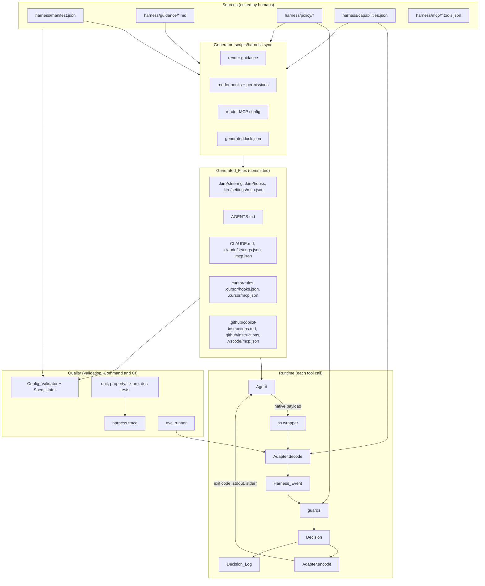

# Design Document: Agent Harness Platform

## Overview

KiroHarness today is a Kiro-only template whose core is already agent-agnostic in spirit: policy lives in data files, guard logic is stdlib Python behind thin `sh` wrappers, `hookio.py` already accepts two payload spellings, and the Config_Validator is offline and modular. This design keeps all of that and adds three layers around it:

1. **An agent-neutral core** (`harness/core/`): one Harness_Event model, guards that map an event to a Decision, and per-Agent Adapters that decode native payloads and encode Decisions.
2. **A single source of truth plus a Generator** (`harness/manifest.json`, `harness/guidance/`, `harness/policy/`, `scripts/harness sync`): every Agent's native files are rendered, committed, and drift-checked.
3. **Measured quality** (Spec_Linter, Traceability_Report, coverage and mutation gates, Eval_Scenarios, Bypass_Corpus, Manual_Check_Records): "spec-driven, documented, tested" becomes something the Validation_Command and CI check, not a promise.

Kiro stays the Primary_Agent. A project that enables only Kiro gets byte-for-byte the same behavior it has today (Requirement 6.8), which is what makes the migration safe.

### Key Decisions

Each row becomes an ADR in `docs/adr/` (Requirement 16.2).

| # | Decision | Choice | Main trade-off |
|---|---|---|---|
| D1 | Source of truth | Neutral `harness/` tree; Agent files (including `.kiro/`) are Generated_Files that stay committed | Agents read their files from fixed paths, so generated output must be in the repo. Committing it costs diff noise; the drift check (6.4) keeps it honest, and adopters who never run the Generator still get working files. |
| D2 | Guard runtime location | Move guard logic from `.kiro/hooks/scripts/lib/` to `harness/core/`; keep `.kiro/hooks/scripts/*.sh` as wrappers that call it | One implementation for every Agent. The move touches many test imports; a compatibility shim in the old `lib/` path keeps one minor release of backward compatibility. |
| D3 | Language and dependencies | Keep Python 3.10+ standard library for all runtime code, POSIX `sh` wrappers; dev-only pinned tools for Hypothesis, coverage, and mutation testing | Same reasoning as the Template spec. Rejecting a template engine (Jinja) means the Generator uses `string.Template` and small render functions, which is more code but zero install. |
| D4 | Guidance canonical format | `harness/guidance/*.md` with Kiro-compatible front matter, rendered to `AGENTS.md` and per-Agent formats | Kiro's inclusion modes are the richest of the supported Agents, so mapping from them loses the least. Agents that read `AGENTS.md` natively get the always-on part for free. |
| D5 | Defense in depth | Hooks plus native permission rules plus guidance, per guard, as the Agent allows | Hooks are the only layer that sees arguments; permissions still hold when a hook is disabled or crashes; guidance shapes behavior before a tool is called. The Capability_Matrix records which layers each Agent has. |
| D6 | Destructive guard scope | Stay pattern-based; measure with a Bypass_Corpus; document known gaps; recommend sandboxing | A shell parser or sandbox would be stronger but is out of scope for a copyable template. Measuring honestly is better than claiming coverage we do not have. |
| D7 | Traceability mechanism | `Validates:` comment tags in tests plus Markdown Manual_Check_Records, collected by `scripts/harness trace` | Lightweight and grep-able, no test framework plugin. Tags can rot, so the Config_Validator checks both directions (14.2). |
| D8 | Capability data | Machine-readable `harness/capabilities.json` with a verification date per entry | Agent formats change monthly. A dated, tested matrix turns "it works in Cursor" into a checkable claim and lets the validator warn when entries go stale (9.4). |

### Assumptions To Verify

Agent formats below are the current understanding at the time of writing. Task 7 verifies each one against official documentation and a real install before an Adapter is built, and records the result in the Capability_Matrix. Confidence is the planning estimate, not a verified fact.

| Agent | Guidance files | Hooks | Permissions | MCP config | Confidence |
|---|---|---|---|---|---|
| Kiro IDE | `.kiro/steering/*.md`; may also read `AGENTS.md` | `.kiro/hooks/*.json` v1; exit 2 blocks; `permissionDecision` on stdout | Hook `ask`; trusted commands setting | `.kiro/settings/mcp.json` | High (implemented; IDE smoke test pending) |
| Claude Code | `CLAUDE.md` (can import `@AGENTS.md`), `.claude/rules/`, skills | `.claude/settings.json` `hooks` per event (`PreToolUse`, `PostToolUse`, `UserPromptSubmit`, `SessionStart`, `Stop`, ...); exit 2 blocks with stderr to the model; JSON `hookSpecificOutput.permissionDecision` `allow`/`deny`/`ask` | `permissions.allow` / `ask` / `deny` rules such as `Bash(...)`, `Read(...)` | `.mcp.json` (`mcpServers`) | High |
| Cursor | `.cursor/rules/*.mdc` (`description`, `globs`, `alwaysApply`); `AGENTS.md` | `.cursor/hooks.json` (for example `beforeShellExecution`, `beforeMCPExecution`, `beforeReadFile`); JSON `permission` output | Hook-based; command allowlist in settings | `.cursor/mcp.json` | Medium |
| GitHub Copilot | `.github/copilot-instructions.md`, `.github/instructions/*.instructions.md` (`applyTo`), `AGENTS.md` | Coding-agent and CLI hooks exist in some surfaces; editor chat may not run hooks | Tool approval in editor; coding agent firewall | `.vscode/mcp.json` (`servers`) | Low to medium |
| OpenAI Codex | `AGENTS.md` | Limited or none at time of writing | Sandbox and approval modes in config | `config.toml` `[mcp_servers]` | Low to medium |
| Gemini CLI | `GEMINI.md` or configured `AGENTS.md` | Hooks in `.gemini/settings.json` | Tool allow and exclude lists | `.gemini/settings.json` `mcpServers` | Low to medium |

If verification shows an Agent has no usable hook event for a guard, the guard degrades to "permission-only" or "guidance-only" for that Agent (Requirement 9.3). No Adapter ships for an Agent until its row is verified.

### Goals and Non-Goals

Goals: every requirement in `requirements.md`; zero behavior change for Kiro-only projects; one policy for all Agents; every criterion traced to a test or a dated manual check.

Non-goals: a sandbox or container runtime; a full shell parser; automatic MCP upgrades; supporting every agent on the market (the Capability_Matrix is the extension point); hosted services or telemetry leaving the machine.

## Architecture



### Target Directory Layout

```text
harness/
  VERSION
  manifest.json
  manifest.schema.json
  capabilities.json
  generated.lock.json
  guidance/            # Guidance_Sources: product, tech, structure, coding-standards,
                       # security, testing, api-design, release-checklist, spec-workflow
  policy/
    destructive-commands.txt
    risky-tools.conf
    protected-paths.txt
    egress-allowlist.txt
  mcp/<server>.tools.json
  core/                # stdlib-only Python package
    event.py           # Harness_Event, Decision, schema version
    guards/            # destructive.py, risky.py, protected_paths.py, prompt_secrets.py
    adapters/          # kiro.py, claude_code.py, cursor.py, copilot.py, ...
    policy.py          # Policy_File loaders (moved from hook lib)
    decision_log.py
    runner.py, hookio.py (moved), masking.py
  templates/           # per-Agent render templates (string.Template)
scripts/
  harness              # sh entry point -> python3 -I -m harness_cli
  harness_cli/         # sync, trace, new-spec, init, upgrade, doctor, log, eval
  harness_validator/   # existing, plus spec_lint, trace_check, policy, capabilities, docs_links
  validate.sh          # existing, now also: sync --check, trace check, evals
evals/
  scenarios/*.json
  corpus/destructive-bypass.txt
  live/                # opt-in live scenarios per Agent
docs/
  README.md            # index (Diataxis)
  tutorials/ how-to/ reference/ explanation/
  adr/NNNN-*.md
  verification/<agent>/<version>/*.md   # Manual_Check_Records
tests/
  core/  adapters/  generator/  spec_lint/  trace/  evals/  docs/
  fixtures/payloads/<agent>/<version>/<trigger>/*.json
  property/test_p29_* ... test_p44_*
.kiro/ AGENTS.md CLAUDE.md .claude/ .cursor/ .github/ .vscode/   # Generated_Files
```

`CLAUDE.md` at the repository root is currently a hand-written maintainer guide. Under D1 it becomes a Generated_File whose body imports `AGENTS.md` and appends a maintainer section rendered from a Guidance_Source, so its content is kept, not lost.

### Runtime Flow

1. The Agent fires an event and runs the wrapper named in its Generated_File, for example `sh .kiro/hooks/scripts/destructive-guard.sh` or `sh harness/bin/guard claude-code destructive`.
2. The wrapper resolves the repository root from its own location (as today), checks for `python3`, and on absence applies the guard's failure semantics in `sh` (deny exits 2; ask prints the ask JSON for that Agent).
3. `python3 -I -m harness.core.cli <agent> <guard>` reads stdin with a size cap (1 MB), the Adapter decodes it into a Harness_Event using the Tool_Map, the guard returns a Decision, the Decision_Log records it, and the Adapter encodes it.
4. Every step has a deadline below the Agent's hook timeout; on deadline the guard's failure semantics apply.

## Components and Interfaces

### 1. Harness_Event and Decision (`harness/core/event.py`)

```python
SCHEMA_VERSION = 1
CATEGORIES = ("shell", "read", "write", "delete", "web", "mcp", "spec", "other")
TRIGGERS = ("session_start", "prompt_submit", "pre_tool", "post_tool",
            "file_saved", "file_created", "file_deleted", "task_done", "stop", "pre_compact")

@dataclass(frozen=True)
class HarnessEvent:
    schema: int
    agent: str                 # key in capabilities.json, e.g. "kiro", "claude-code"
    agent_version: str | None
    trigger: str               # one of TRIGGERS
    tool_id: str | None        # native ID, e.g. "execute_bash", "Bash", "@git/git_commit"
    category: str | None       # one of CATEGORIES
    command: str | None
    paths: tuple[str, ...]     # workspace-relative where possible
    url: str | None
    prompt: str | None
    raw_fields: tuple[tuple[str, str], ...]   # flattened tool_input, for regex predicates
    cwd: str | None

@dataclass(frozen=True)
class Decision:
    kind: Literal["allow", "ask", "deny"]
    guard: str
    reason: str
    matched: str | None        # policy entry text, never a secret value
```

Guards are pure functions `evaluate(event, policy) -> Decision`, so they are property-testable without subprocesses.

### 2. Adapters (`harness/core/adapters/<agent>.py`)

```python
class Adapter(Protocol):
    agent: str
    def decode(self, raw: bytes, trigger_hint: str) -> HarnessEvent   # raises DecodeError
    def encode(self, decision: Decision, event: HarnessEvent | None) -> Output
    # Output = (exit_code, stdout_bytes, stderr_bytes)
```

- `kiro.py` absorbs today's `hookio.py` logic (snake_case and camelCase payloads, `control_bash_process` stop calls) and today's exit-2 and `permissionDecision` encodings.
- Each Adapter reads its Tool_Map and output contract from `capabilities.json`, so a renamed tool ID is a data change.
- A `DecodeError` turns into the guard's failure Decision (Requirement 4.4) before encoding.

### 3. Guards (`harness/core/guards/`)

| Guard | Input categories | Failure semantics | Origin |
|---|---|---|---|
| destructive | `shell` | deny | moved from `destructive_guard.py`, unchanged matching |
| risky | any | ask | moved from `risky_guard.py`; tool column gains `category:` and `agent:` forms |
| protected_paths | `read`, `write`, `delete`, `shell` | deny | new (Requirement 11) |
| prompt_secrets | prompt trigger | deny | moved from `prompt_scan.py` |
| quality, post_task, session_info | file and lifecycle triggers | informational, fail open | moved, Kiro-first; other Agents where events exist |

Ordering when several guards apply to one event: destructive, protected_paths, risky. The first `deny` wins, otherwise the first `ask`, otherwise `allow`. This is one combined hook per event per Agent, which avoids relying on each Agent's multi-hook ordering rules.

### 4. Policy loading (`harness/core/policy.py`)

Moves the current parsers. New formats:

- `protected-paths.txt`: one glob per line using the existing `globmatch.py` semantics; `!pattern` re-includes (used for `.env.example`).
- `egress-allowlist.txt`: one host per line; subdomains allowed, as in today's `host-not-in`.
- `risky-tools.conf` tool column: `<kiro-tool-id>` (backward compatible), `category:<name>`, or `<agent>:<tool-id>`.

### 5. Generator (`scripts/harness_cli/sync.py`)

```text
load manifest + schema check
for agent in manifest.agents if enabled:
    for target in renderers[agent]:      # guidance, hooks, permissions, mcp
        content = target.render(sources, capabilities[agent])
        plan.add(path, content, sources)
compare plan with disk and generated.lock.json
  --check: report drift, exit 0/1
  default: refuse hand-edited files (hash mismatch with lock) unless --force; write; update lock
```

Rendering rules:

- Output is normalized: LF endings, one trailing newline, sorted JSON keys where the target format does not define an order, Kiro hook JSON through the existing Hook_Config_Printer.
- Inclusion mapping (verified in Task 7): `always` to Kiro `always`, `AGENTS.md` body, Cursor `alwaysApply: true`, Copilot `copilot-instructions.md`; `fileMatch` to Kiro `fileMatch`, Cursor `globs`, Copilot `applyTo`, Claude Code path-scoped rule where supported; `auto` to Kiro `auto`, Cursor `description` only, Claude Code skill; `manual` to Kiro `manual`, Cursor rule without globs, a doc linked from `AGENTS.md` elsewhere.
- Placeholders stay in Guidance_Sources and are copied through unchanged; the placeholder scan runs on sources, and Generated_Files are excluded from it to avoid double counting.

### 6. Config_Validator extensions (`scripts/harness_validator/`)

| Module | Checks | Criteria |
|---|---|---|
| `policy.py` | Policy_File syntax, unknown categories or Agents, regex compile | 5.4 |
| `capabilities.py` | matrix schema, enabled Agent present, staleness | 9.4 |
| `manifest.py` | schema, references to existing sources | 6.1 |
| `drift.py` | calls the Generator in check mode | 6.4 |
| `context_budget.py` | Always_On_Context size per Agent | 7.3 |
| `spec_lint.py` | structure, EARS, design sections, task references | 13.1 to 13.4 |
| `trace_check.py` | criterion coverage both directions | 14.2 |
| `mcp_inventory.py` | `autoApprove` within tool inventory, minimum versions for every rendered config | 10.4, 10.6 |
| `docs_links.py` | relative links resolve; CHANGELOG matches VERSION | 16.5, 16.6 |

All new checkers run inside `Run.guarded`, so a crash in one is an `[INTERNAL]` finding and the run continues (existing contract).

### 7. Traceability (`scripts/harness_cli/trace.py`)

- Parses Criterion_IDs from every `requirements.md` (headings `### Requirement N` and numbered criteria).
- Parses task references from `_Requirements: N.M, ..._` lines and `Validates:` lines in `tasks.md`.
- Scans `tests/**/*.py` for `Validates:` tags in comments or docstrings; scans `docs/verification/**.md` front matter for `criteria:` lists.
- Reads the last test run result (`build/test-results.json`, written by `tests/_result.py`) to mark each linked test passed, failed, or skipped.
- Emits Markdown to stdout and JSON to `build/traceability.json`.

The existing tests get retro-tagged (Task 2.3), using the Template spec's own "Validates: Requirements" lines in `tasks.md` and the property-to-requirement mapping in its design as the starting map.

### 8. Decision_Log (`harness/core/decision_log.py`)

Append-only JSON Lines, opened with `O_APPEND`, one `write` call per record under 4 KB so concurrent hooks do not interleave. Command, path, and URL summaries are masked with the existing `secrets.py` logic and truncated to 200 characters. Rotation is checked before each write. All failures are swallowed into one stderr warning (12.3).

### 9. Evals (`evals/`, `scripts/harness_cli/eval.py`)

- Scenario format: Agent-neutral steps (`{trigger, category, tool, input}`) plus expected Decision; the runner renders each step into each Adapter's native payload using the recorded fixtures as templates, then runs the full wrapper as a subprocess. This tests decode, guard, and encode together.
- Bypass_Corpus line format: `must-block | <command>` or `known-gap | <command> | <note>`.
- Live evals: per-Agent driver scripts that start the Agent CLI in non-interactive mode inside a `TemplateCopy`, with a fixed prompt that asks for a destructive action, and assert from the Decision_Log that the guard fired. Opt-in only.

### 10. CI (`.github/workflows/`)

| Workflow | Trigger | Jobs |
|---|---|---|
| `ci.yml` | push, pull_request | matrix {ubuntu, macos} x {3.10, newest 3.x}: validate.sh, test-properties.sh (ci profile), coverage gate, trace check |
| `nightly.yml` | weekly schedule, manual | mutation testing on guards; Bypass_Corpus report; `check-mcp-updates.sh` with OSV |
| `integration.yml` | manual, weekly | MCP integration suite with tool inventory comparison; never on fork PRs |

All actions are SHA-pinned; `permissions: contents: read`; no secrets are needed for the offline jobs.

### 11. CLI (`scripts/harness`)

`sync [--check] [--force]`, `trace`, `new-spec <name>`, `init <dir> [--agents ...]`, `upgrade --from <src>`, `doctor`, `log --summary`, `eval [--live]`. Every subcommand has `--help`, a reference page in `docs/reference/cli.md`, exit codes 0 (ok), 1 (findings), 2 (usage or internal error), matching the validator convention.

## Data Models

### Manifest (`harness/manifest.json`)

```json
{
  "schema": 1,
  "harness_version": "1.0.0",
  "agents": {
    "kiro": {"enabled": true},
    "claude-code": {"enabled": false},
    "cursor": {"enabled": false},
    "copilot": {"enabled": false}
  },
  "guidance": ["harness/guidance/*.md"],
  "guards": {
    "destructive": {"enabled": true},
    "risky": {"enabled": true},
    "protected_paths": {"enabled": true},
    "prompt_secrets": {"enabled": true}
  },
  "quality": {"on_save": true, "post_task": true, "stop_validate": true},
  "mcp": {
    "git": {"package": "mcp-server-git", "version": "2026.11.18",
            "args": ["--repository", "."], "disabled": false,
            "auto_approve": ["git_status", "git_diff", "git_log"]}
  }
}
```

### Capability_Matrix entry (`harness/capabilities.json`)

```json
{
  "claude-code": {
    "verified": {"min": "X.Y.Z", "max": "X.Y.Z", "date": "YYYY-MM-DD", "source": "docs URL + docs/verification path"},
    "guidance": {"always": "CLAUDE.md", "fileMatch": "...", "auto": "...", "manual": "..."},
    "events": {"pre_tool": {"native": "PreToolUse", "payload": "...", "block": "exit2", "ask": "json"}},
    "tool_map": {"Bash": {"category": "shell", "command": "command"},
                 "Read": {"category": "read", "paths": ["file_path"]}},
    "permissions": "settings.permissions",
    "mcp": {"path": ".mcp.json", "root_key": "mcpServers"},
    "protection": {"destructive": "enforced", "risky": "enforced", "protected_paths": "enforced"}
  }
}
```

Values shown as `X.Y.Z` and `...` are filled in by Task 7 from verification; they are not placeholders in the Template sense.

### Validates_Tag

```python
# Validates: agent-harness-platform/R4.4, kiro-agent-harness-template/R11.8
```

One tag line per test method or module; a module-level tag applies to every test in the module.

### Manual_Check_Record (`docs/verification/<agent>/<version>/<check>.md`)

```markdown
---
criteria: [agent-harness-platform/R3.4]
agent: kiro
agent_version: X.Y.Z
os: macOS 15.x
date: YYYY-MM-DD
verdict: pass        # pass | fail | partial
---
## Steps
## Observed
## Notes
```

### Decision_Log record

```json
{"ts":"2026-11-21T14:00:00Z","agent":"kiro","trigger":"pre_tool","category":"shell",
 "tool":"execute_bash","decision":"deny","guard":"destructive",
 "matched":"git push --force","summary":"git push --force origin main"}
```

### Tool inventory (`harness/mcp/<server>.tools.json`)

```json
{"package": "mcp-server-git", "version": "2026.11.18",
 "tools": {"git_status": "sha256:<hex>", "git_diff": "sha256:<hex>"}}
```

## Correctness Properties

Property numbers continue from the Template spec (1 to 28) so that `tests/property/test_pNN_*.py` stays one flat, unique sequence.

### Property 29: Adapter round trip
For every Agent with an Adapter and every valid Harness_Event that Agent can express, encoding the event as a native payload with the test-side payload builder and decoding it gives an equal event. **Validates: R4.2, R4.6**

### Property 30: Decode failure applies guard failure semantics
For every Adapter, every guard, and every byte string that is not a decodable payload, the encoded output equals the guard's failure Decision encoding (deny or ask). **Validates: R4.4**

### Property 31: Cross-agent decision equivalence
For every Agent-neutral event content and every pair of Agents whose Capability_Matrix marks a guard as enforced, the guards return the same Decision. **Validates: R5.3**

### Property 32: Guard combination order
For every list of guard Decisions, the combined Decision is the first `deny` if any, else the first `ask` if any, else `allow`, and the reason names the deciding guard. **Validates: R4.7**

### Property 33: Unknown tools with command fields ask
For every unmapped tool ID whose input contains a command-like field, the Risky_Tool_Guard returns `ask`. **Validates: R4.5**

### Property 34: Generator determinism and idempotence
For every valid Manifest and source set, two Generator runs produce byte-identical file sets, and a run over its own output reports no Drift. **Validates: R6.3, R6.4**

### Property 35: Kiro output equivalence
For the shipped sources with only Kiro enabled, every Generated_File under `.kiro/` is byte-identical to the corresponding file in the pre-migration baseline, after the documented header addition. **Validates: R6.8**

### Property 36: Inclusion mapping preserves selection
For every Guidance_Source with a file pattern and every path, the rendered rule for each Agent that supports file patterns selects the path if and only if the source pattern selects it. **Validates: R7.1**

### Property 37: Hand-edit protection
For every Generated_File and every edit to it, `sync` without `--force` exits 1, names the file, and leaves the file unchanged. **Validates: R6.6**

### Property 38: Protected-path decisions
For every path, the protected-path guard returns `deny` exactly when a reference matcher (written independently in the test) says the path matches the protected list after re-includes. **Validates: R11.1, R11.2**

### Property 39: No secret reaches any output channel
For every generated secret value from each secret pattern, placed in a command, path, URL, or prompt, the value does not appear in stdout, stderr, the Decision_Log, or the Validation_Report. **Validates: R11.4, R12.1**

### Property 40: Decision_Log failures never change the Decision
For every event and every injected log write failure, the encoded output equals the output with logging disabled. **Validates: R12.3**

### Property 41: Spec_Linter task references
For every generated spec with a random set of Criterion_IDs and task references, the Spec_Linter reports exactly the references to missing IDs as errors and exactly the unreferenced IDs as warnings. **Validates: R13.4**

### Property 42: Traceability completeness
For every generated set of criteria, tests with tags, and Manual_Check_Records, the trace check reports exactly the uncovered criteria and exactly the dangling tags. **Validates: R14.1, R14.2**

### Property 43: EARS classification
For every acceptance criterion string built from the EARS grammar the Spec_Linter accepts it, and for every string that starts with none of the keyword patterns it reports an error. **Validates: R13.2**

### Property 44: Policy_File parse round trip
For every valid parsed Policy_File, printing it in canonical form and parsing it again gives an equal policy. **Validates: R5.1, R5.4**

## Error Handling

The Template spec rule is kept: guards fail closed, informational hooks fail open, the validator never stops early. Additions:

| Component | Failure | Behavior | Criteria |
|---|---|---|---|
| Adapter | payload undecodable, over 1 MB, or wrong trigger | guard failure Decision; stderr names the Agent and the problem | 4.4 |
| Adapter | tool ID unmapped | category `other`; risky asks if a command-like field exists | 4.5 |
| Protected-path guard | policy missing or empty | deny, message names the file | 11.5 |
| Any guard | deadline reached | failure Decision for that guard | 4.4 (by extension) |
| Decision_Log | write or rotate fails | Decision unchanged; one stderr warning | 12.3 |
| Generator | Manifest schema error | exit 2, no files written | 6.1 |
| Generator | hand-edited Generated_File | exit 1, file named, nothing written | 6.6 |
| Generator | target format cannot express inclusion | fallback plus warning | 7.2 |
| Spec_Linter | spec unparsable | one error for the file, continue | 13.1 |
| trace | no test results file | coverage still computed from tags; status `unknown` per test | 14.1 |
| `upgrade` | conflict in a developer-edited file | file left unchanged, three-way diff printed, exit 1 | 17.3 |
| Live evals | Agent CLI missing | scenario skipped with reason | 15.5 |

Messages keep the existing convention: they start with the component name and a colon, and never contain an unmasked secret.

### Migration and Compatibility

1. `harness/core/` is introduced alongside the existing hook `lib/`. The old modules become re-export shims, and `tests/_support.py` gains the new path.
2. The Kiro Adapter is proven equivalent with the existing hook tests plus the recorded Kiro payloads before the shims are switched over (Property 35, Task 9 checkpoint).
3. Policy_Files move to `harness/policy/`; `.kiro/hooks/scripts/` keeps symlink-free copies generated by the Generator for one minor release, then the wrappers read `harness/policy/` directly.
4. The Template spec stays the normative spec for Kiro behavior; this spec references it rather than duplicating it.

### Risks

| Risk | Likelihood | Impact | Mitigation |
|---|---|---|---|
| Agent hook formats change after verification | High | Adapter breaks silently | Capability_Matrix dates and staleness warning; recorded payload fixtures; weekly reminder in nightly workflow |
| Generated files bloat diffs and confuse adopters | Medium | Adoption friction | Header comments, `harness doctor`, docs page "what is generated" |
| Regex guard gives false confidence | Medium | Data loss | Bypass_Corpus metrics in README; sandbox recommendation (15.4) |
| Scope creep across many Agents | High | Plan never finishes | Phases are independently shippable; Adapters beyond Claude Code are gated on Task 7 verification |
| Always_On_Context grows with every Agent | Medium | Worse agent performance | Context budget check (7.3); progressive disclosure through fileMatch, auto, and manual guidance |

## Testing Strategy

### Test Layers

| Layer | Location | Runner | Network | Run by |
|---|---|---|---|---|
| Unit (core, guards, adapters, generator, CLI) | `tests/core`, `tests/adapters`, `tests/generator` | stdlib `unittest` | no | validate.sh, CI |
| Payload fixture tests | `tests/adapters/test_fixtures_<agent>.py` over `tests/fixtures/payloads/` | `unittest`, subprocess through the real wrapper | no | validate.sh, CI |
| Property tests P1 to P44 | `tests/property/` | `unittest` + Hypothesis | first install | test-properties.sh, CI (ci profile) |
| Spec and trace tests | `tests/spec_lint`, `tests/trace` | `unittest` | no | validate.sh, CI |
| Documentation tests | `tests/docs` (extends `test_docs_examples.py`) | `unittest` | no | validate.sh, CI |
| Offline evals | `evals/` via `tests/evals/test_scenarios.py` | `unittest` | no | validate.sh, CI |
| Coverage gate | all of the above | pinned coverage tool | no | CI |
| Mutation testing | guard modules | pinned mutation tool | no | nightly |
| MCP integration | `tests/integration` | `unittest`, `HARNESS_INTEGRATION=1` | yes | integration workflow |
| Live evals and manual checks | `evals/live`, `docs/verification` | per-Agent scripts, humans | yes | before release |

### Rules That Apply to Every Task

- **Test first for behavior.** Each implementation task names the tests that must fail before the change and pass after it.
- **Tag every test** with a Validates_Tag. A test without a tag fails the trace check once Task 2.3 lands.
- **One property, one test module.** Properties 29 to 44 map to `tests/property/test_p29_*.py` through `test_p44_*.py`, each importing `tests.property._profiles` first and carrying `# Feature: agent-harness-platform, Property N: <title>`.
- **Independent reference models** for Properties 31, 36, 38, 42, written as simple loops in the test module.
- **Fixtures are real.** Adapter tests use recorded payloads; synthetic payloads are only for property tests and are built from the same Tool_Map.
- **No network in the default path.** Anything that needs network is behind an environment flag and a separate workflow.
- **Docs are tests.** Every new command, Policy_File format, and Agent section ships with an `example=` block that the docs tests execute.

### Quality Gates

| Gate | Threshold | Where |
|---|---|---|
| Validation_Command | exit 0 | pre-commit, CI |
| Property suite | all pass at 300 examples | CI |
| Drift | none | validate.sh, CI |
| Traceability | zero uncovered criteria, zero dangling tags | validate.sh, CI |
| Coverage | line at least 90 percent, branch at least 80 percent per package | CI |
| Mutation score | at least 85 percent per guard module | nightly |
| Bypass_Corpus | zero `must-block` allowed | validate.sh, CI |
| Manual checks | at most 30 days old for "enforced" Agents | release checklist |

## Rollout

| Phase | Requirements | Outcome | Ships as |
|---|---|---|---|
| 0 Baseline | 1, 2 | Clean, CI-gated repository | 0.2.0 |
| 1 Kiro verification | 3 | Kiro contracts verified and recorded | 0.3.0 |
| 2 Core | 4, 5 | Agent-neutral core, Kiro behavior unchanged | 0.4.0 |
| 3 Generator | 6, 7 | Single source of truth, `AGENTS.md` | 0.5.0 |
| 4 Adapters | 8, 9, 10 | Claude Code enforced; others per matrix | 0.6.0 |
| 5 Security and quality | 11 to 15 | Protected paths, audit log, spec lint, trace, evals | 0.7.0 to 0.9.0 |
| 6 Docs and release | 16, 17 | Diataxis docs, init, upgrade, doctor | 1.0.0 |

Each phase ends with a checkpoint task: the Validation_Command, the property suite, and the trace check pass, and `docs/IMPLEMENTATION_STATUS.md` is updated.
