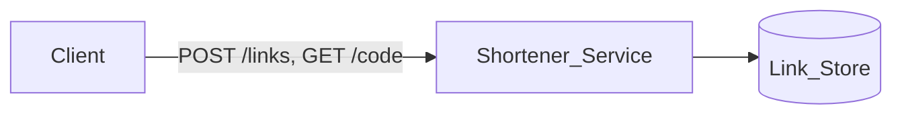

# Design Document: URL Shortener (example)

## Overview

The Shortener_Service is one HTTP service with two endpoints: `POST /links`
creates a Short_Link and `GET /{code}` resolves it. Links are stored in one
database table, the Link_Store.

## Architecture

The service is stateless, so it can run as several instances behind a load
balancer.

## Components and Interfaces

- `POST /links` with body `{"url": "<target>"}` returns `201 {"code": "<7 chars>"}`
  or `400 {"error": "url must be an http or https URL"}`.
- `GET /{code}` returns `301` with a `Location` header, `404`, or `503`.
- `generate_code()` returns 7 random characters from `[A-Za-z0-9]`, using a
  cryptographically secure random source.

## Data Models

| Column | Type | Notes |
|---|---|---|
| `code` | `char(7)` | primary key |
| `target_url` | `text` | validated http or https URL |
| `created_at` | `timestamp` | set on insert |

## Error Handling

- Invalid input returns 400 with the field name (Requirement 1.2).
- An unknown code returns 404 (Requirement 2.2).
- A Link_Store connection failure returns 503 and is logged (Requirement 2.3).
- A code collision on insert is retried up to 3 times with a new code.

## Testing Strategy

- Unit tests for URL validation and `generate_code()`.
- A property test that every generated code has 7 characters from the allowed set.
- Integration tests for both endpoints against a test database, including the
  503 path with the database stopped.
