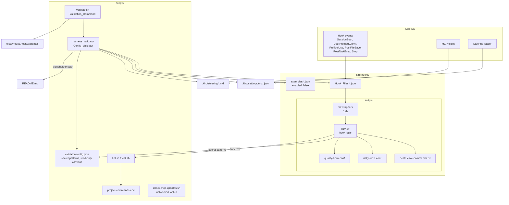
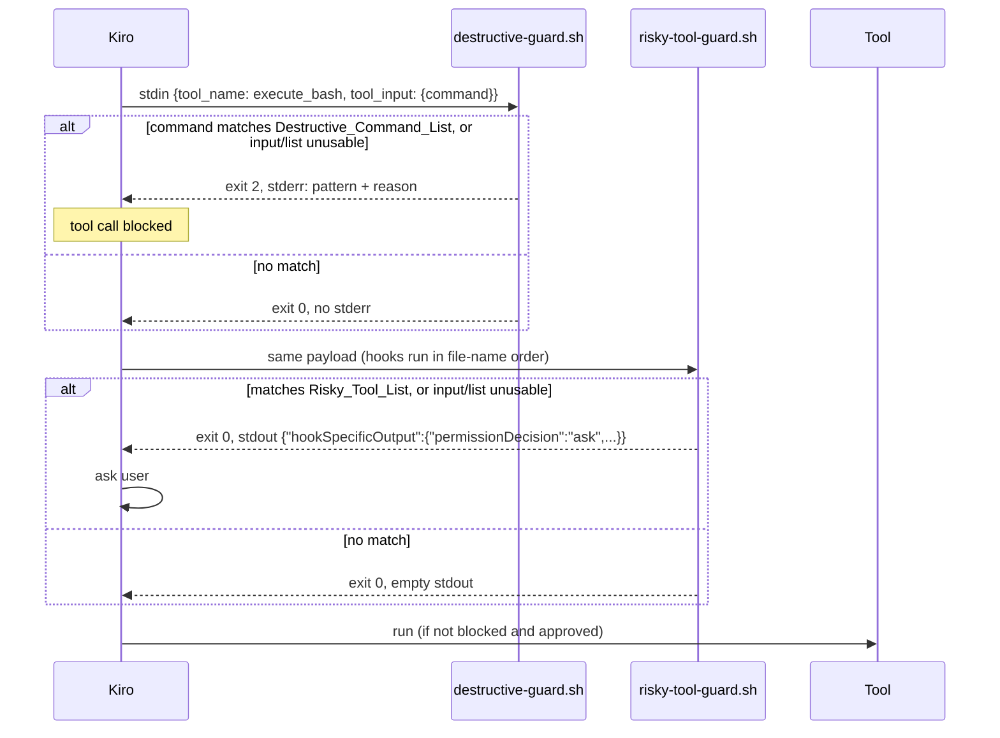
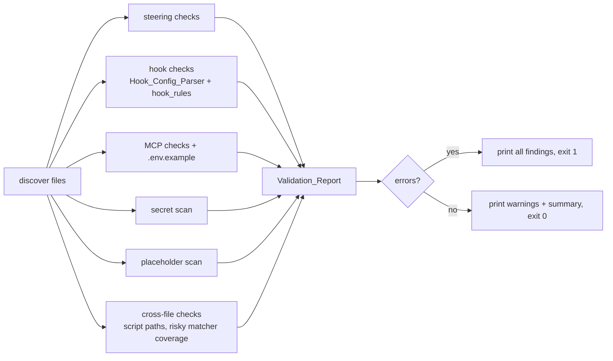

# Design Document: Kiro Agent Harness Template

## Overview

The Template is a copyable repository skeleton that gives a project a working Kiro agent harness: steering files, v1 hook files with guard and quality scripts, a workspace MCP configuration, an example spec, documentation, and a self-check (the Config_Validator plus hook script tests) that a developer runs with one command.

The design settles three open decisions:

| Decision | Choice | Main trade-off |
|---|---|---|
| Runtime for the Config_Validator, Hook_Config_Parser/Printer, and hook logic | Python 3.10+ standard library only. Hook_Scripts are thin POSIX `sh` wrappers that `exec` Python modules. Hypothesis is a pinned, dev-only dependency used only by the property test suite. | Python is not guaranteed on every machine (macOS ships a stub `python3` that may prompt to install Command Line Tools). In exchange we get a real JSON parser with line/column errors, `re`, `subprocess` timeouts, and a mature PBT library. bash+jq cannot report JSON parse positions and makes the round-trip/idempotence properties hard to test; Node adds a second runtime next to the `uv`/Python stack the MCP servers already need. |
| MCP server version pinning | `uvx <package>@<X.Y.Z>` in `args`, checked by the Config_Validator. Updates are found by an opt-in, networked `scripts/check-mcp-updates.sh` and an optional Renovate regex manager example; nothing updates automatically. | Pinning means manual bumps, but each bump is reviewed, and a known-vulnerable version cannot be pulled in silently. Unpinned `@latest` is what upstream READMEs show and is rejected by Requirement 8.4. |
| Mapping guards to Kiro tool names | Matchers are anchored regular expressions over exact Kiro tool IDs (`^(execute_bash\|execute_pwsh\|control_bash_process)$` for the Destructive_Command_Guard). Matchers avoid `*` and `?` because Kiro treats those as wildcards in hook JSON. The Risky_Tool_List names exact tool IDs, and the Config_Validator checks that the Risky_Tool_Guard matcher covers every listed tool. | Exact IDs must be updated when Kiro adds or renames a shell tool. The built-in `shell` category selector would track new tools automatically, but Kiro's editor evaluates matcher entries as regexes against tool IDs, so a bare `shell` would match any ID containing that text, and Requirement 3.6 requires a matcher that is a valid regex selecting the targeted tools. |

### Research Findings

- **Hook file format and matcher semantics.** Hooks are `.kiro/hooks/<id>.json` files with `version: "v1"` and a `hooks` array; `timeout` defaults to 60 s, and optional fields include `description`, `enabled`, and `confirm` ([Kiro hooks docs](https://kiro.dev/docs/hooks/)). For tool triggers the matcher may be an exact tool ID, a category (`read`, `write`, `shell`, `web`, `spec`), a source selector (`@mcp`, `@<server>`, `@<server>/<tool>`), a regex against the tool ID, or a `*`/`?` wildcard pattern in JSON files ([Kiro hook types](https://kiro.dev/docs/hooks/types/)).
- **Hook stdin payload.** Kiro IDE 1.x writes JSON to stdin and closes it, using snake_case fields `session_id`, `hook_event_name`, `cwd`, `tool_name`, `tool_input`, `tool_response`. Kiro 0.12 used camelCase `toolName`/`toolArgs`. Shell `PreToolUse` input is `{command, cwd, run_in_background, timeout}`; the shell tool is `execute_bash` (`execute_pwsh` on Windows). Some builds deliver an empty `prompt` on `UserPromptSubmit` and empty `tool_input` on `PostToolUse` ([AI-DLC Kiro IDE hook payload reference](https://awslabs.github.io/aidlc-workflows/reference/kiro-ide-hook-payload/)).
- **Blocking behavior.** A `PreToolUse` refusal is reliable when the reason goes to stderr and the hook exits 2; measured on Kiro IDE 1.1.14, `permissionDecision: "deny"` on stdout with exit 0 did not block. Several `PreToolUse` hooks run in file-name order and all run even after one blocks (same source). The design therefore makes the Destructive_Command_Guard block with exit 2, and treats the Risky_Tool_Guard's `"ask"` output as the documented contract that the smoke test in the Testing Strategy must confirm on the target Kiro version.
- **MCP packages and versions.** Current releases on PyPI: `awslabs.aws-documentation-mcp-server` 1.2.6, `mcp-server-fetch` 2026.11.18, and `mcp-server-git` 2026.11.18 ([PyPI awslabs.aws-documentation-mcp-server](https://pypi.org/project/awslabs.aws-documentation-mcp-server/), [PyPI mcp-server-fetch](https://pypi.org/project/mcp-server-fetch/), [PyPI mcp-server-git](https://pypi.org/project/mcp-server-git/)). The two reference servers use calendar versions, which still have the `major.minor.patch` shape required by Requirement 8.4. The AWS documentation README configures the server with `@latest`.
- **Why pinning matters for the git server.** `mcp-server-git` has had three advisories about escaping `--repository` confinement; the latest (GHSA-w766-5x43-whvw, nested `.git` file) is fixed in 2026.10.28, and the earlier ones were fixed in 2025.12.18 and 2026.1.14 ([dev.to write-up](https://dev.to/rulestack/a-nested-git-file-let-the-git-mcp-server-out-of-its-repository-until-20261028-which-version-3e1l)). The Template pins a version at or above 2026.10.28, and the Config_Validator keeps a minimum-version floor for this package.

Content from the sources above was rephrased for compliance with licensing restrictions.

### Goals and Non-Goals

Goals: every requirement in `requirements.md`, an offline validator, fail-closed guards, and tests that read the guard lists at run time.

Non-goals: supporting Kiro CLI-only payload variants beyond accepting both field spellings, automatic MCP version upgrades, and linting or testing in any specific language (the developer supplies commands through placeholders).

## Architecture



### Directory Layout

```
README.md                         Template_README
.env.example                      Env_Example_File
.gitignore
requirements-dev.txt              hypothesis==<exact version>, dev-only
docs/CUSTOMIZING.md               Customization_Guide
.kiro/
  steering/
    product.md tech.md structure.md security.md      inclusion: always
    coding-standards.md testing.md                    inclusion: fileMatch
    release-checklist.md                              inclusion: manual
    api-design.md                                     inclusion: auto
  hooks/
    destructive-command-guard.json   PreToolUse
    risky-tool-guard.json            PreToolUse
    quality-on-save.json             PostFileSave
    session-start-context.json       SessionStart
    prompt-secret-scan.json          UserPromptSubmit
    post-task-tests.json             PostTaskExec
    stop-validate.json               Stop (agent action)
    examples/
      new-file-reminder.json         PostFileCreate, enabled: false
      pre-compact-snapshot.json      PreCompact, enabled: false
    scripts/
      destructive-guard.sh  risky-tool-guard.sh  quality-on-save.sh
      session-start.sh      prompt-secret-scan.sh post-task-tests.sh
      destructive-commands.txt   Destructive_Command_List
      risky-tools.conf           Risky_Tool_List
      quality-hook.conf          test-file name pattern
      lib/  hookio.py destructive_guard.py risky_guard.py quality.py
            session_info.py prompt_scan.py runner.py
  settings/mcp.json                  MCP_Config
  specs/example-feature/requirements.md design.md tasks.md
scripts/
  validate.sh                Validation_Command (validator + hook script tests)
  validate-config.sh         Config_Validator entry point
  lint.sh  test.sh           Lint_Command, Test_Command
  project-commands.env       command definitions (placeholders by default)
  test-properties.sh         property test suite (needs Hypothesis)
  check-mcp-updates.sh       networked, never run by hooks
  validator-config.json      Secret_Pattern_List, Read_Only_Allowlist, MCP floors
  harness_validator/         Python package
    __main__.py report.py hookconfig.py hook_rules.py frontmatter.py
    steering.py globmatch.py mcp.py envfile.py secrets.py placeholders.py
tests/
  hooks/       guard and hook script tests (stdlib unittest, subprocess)
  validator/   example tests with fixtures
  property/    Hypothesis property tests
  fixtures/
```

The Config_Validator checks JSON files directly in `.kiro/hooks/` and in `.kiro/hooks/examples/`. It does not treat files under `.kiro/hooks/scripts/` as Hook_Files. For this reason the guard lists use line-based formats (`.txt`, `.conf`) rather than JSON, so neither Kiro nor a reader mistakes them for hook definitions.

### Hook Execution Flow



### Runtime Decision Detail

- **Declared runtime.** `tech.md` declares Python 3.10 or newer and POSIX `sh`. The validator imports only the standard library (`json`, `re`, `pathlib`, `subprocess`, `dataclasses`, `os`, `stat`). This satisfies Requirement 10.11.
- **Shell wrappers.** Requirement 1.5 and the Hook_Script definition require shell scripts. Each wrapper is about ten lines: it locates the workspace root from its own path, checks `command -v python3`, and `exec`s `python3 -I "$dir/lib/<module>.py"`. `-I` (isolated mode) ignores `PYTHON*` environment variables and the user site directory, so a hostile environment cannot inject modules. If Python is missing, the wrapper fails closed on its own: the Destructive_Command_Guard wrapper exits 2 with a message, and the Risky_Tool_Guard wrapper prints the `"ask"` JSON with `printf`.
- **YAML front matter without a YAML library.** The standard library has no YAML parser. `frontmatter.py` implements the subset that Kiro steering front matter uses: `key: value` scalars (plain, single-quoted, double-quoted), booleans, flow sequences of scalars (`[a, "b"]`), block sequences (`- a`), and `#` comments. Any other construct (nested mappings, anchors, multi-line scalars, tabs for indentation) is reported as invalid YAML for that file (Requirement 10.12). Trade-off: a valid but unusual YAML front matter is rejected; the Customization_Guide documents the supported subset.
- **Property tests.** Hypothesis is pinned in `requirements-dev.txt` and is run by `scripts/test-properties.sh` via `uv run --with-requirements requirements-dev.txt` (uv is already required by the MCP servers) or a local virtualenv. It is not imported by the validator or by any hook, so the offline, no-dependency rule holds for everything Kiro runs. `scripts/validate.sh` runs the validator and the stdlib hook script tests (Requirement 11.5) and does not need network access. CI runs both commands.

### MCP Version Pinning and Updates

- `args` take the form `["<package>@<X.Y.Z>", ...]`. The validator accepts the package spec in `args[0]`, or after `--from`. The version must match `^\d+\.\d+\.\d+$`; ranges, `==`/`>=` specifiers, `latest`, wildcards, and bare names are errors (Requirement 8.4, 8.9).
- `validator-config.json` holds `mcp_minimum_versions`, initially `{"mcp-server-git": "2026.10.28"}`. A pin below a floor is an error, so a bump cannot go backwards past a known security fix.
- `scripts/check-mcp-updates.sh` reads `mcp.json`, queries `https://pypi.org/pypi/<package>/json` for `info.version`, and prints a table of pinned versus latest. It changes no files. It is never called by a hook or by `validate.sh`, which keeps the validator offline.
- `docs/CUSTOMIZING.md` includes an optional Renovate `customManagers` regex example that matches `"<package>@<version>"` in `.kiro/settings/mcp.json` with the `pypi` datasource, for teams that want update pull requests. Each bump still goes through review and `scripts/validate.sh`.

Initial pins:

| Server key | Package | Pin | `args` |
|---|---|---|---|
| `aws-docs` | `awslabs.aws-documentation-mcp-server` | 1.2.6 | `["awslabs.aws-documentation-mcp-server@1.2.6"]` |
| `fetch` | `mcp-server-fetch` | 2026.11.18 | `["mcp-server-fetch@2026.11.18"]` |
| `git` | `mcp-server-git` | 2026.11.18 | `["mcp-server-git@2026.11.18", "--repository", "."]` |

The implementer re-checks these versions on PyPI when building the Template and records the date checked in `tech.md`.

**Git server confinement (Requirement 8.8).** `--repository .` relies on Kiro starting workspace MCP servers with the workspace root as the working directory. Kiro's documentation does not state this, so a smoke test (start the server, call `git_status`, confirm the reported path is the workspace root) is part of the Testing Strategy. If the smoke test fails on the target Kiro version, the fallback is an absolute path through a `{{WORKSPACE_ROOT}}` placeholder that each developer replaces locally. The validator enforces that the git entry's `args` contain `--repository` followed by `.` or an absolute path, and never a parent-relative path (`..`).

### Tool Name Mapping

Kiro IDE built-in tool IDs used by the Template (from the hook payload research and the IDE's own tool list):

| Purpose | Tool IDs | Used by |
|---|---|---|
| Shell execution | `execute_bash`, `execute_pwsh`, `control_bash_process` (background processes) | Destructive_Command_Guard matcher, Risky_Tool_List deploy entries |
| File deletion | `delete_file` | Risky_Tool_List |
| Network fetch | `web_fetch` | Risky_Tool_List (host allowlist) |
| MCP git mutations | `@git/git_commit`, `@git/git_reset`, `@git/git_checkout`, `@git/git_create_branch`, `@git/git_add` | Risky_Tool_List (optional entries, MCP tool IDs use `@<server>/<tool>`) |

- Destructive_Command_Guard matcher: `^(execute_bash|execute_pwsh|control_bash_process)$`.
- Risky_Tool_Guard matcher: an anchored alternation of every tool name in `risky-tools.conf`. The validator recomputes coverage: every tool name in the list must fully match the matcher (Requirement 5.1).
- Payload field names: the hook library reads `tool_name` or `toolName`, and `tool_input` or `toolArgs`. If `tool_input` arrives as a JSON-encoded string it is decoded once. The shell command is `tool_input.command`.
- **`control_bash_process` stop calls.** A `control_bash_process` call with `action: "stop"` carries a `terminalId` and no command. Under a literal reading of Requirement 4.4 the guard would block every attempt to stop a background process. The design treats `control_bash_process` with `action == "stop"` as not a shell execution and exits 0. Every other input without a non-empty string command still fails closed with exit 2. This is a deviation from the letter of Requirement 4.4 and needs a requirements amendment; the alternative, leaving `control_bash_process` out of the matcher, would let background commands bypass the guard.
- The tool list must be revisited when Kiro adds shell tools. `docs/CUSTOMIZING.md` tells developers to ask Kiro for its tool names and update both the matcher and the list.

## Components and Interfaces

### 1. Steering Files

| File | Inclusion | Front matter |
|---|---|---|
| `product.md`, `tech.md`, `structure.md`, `security.md` | `always` | `inclusion: always` |
| `testing.md` | `fileMatch` | `fileMatchPattern: ["**/*.test.*", "**/*.spec.*", "**/test_*.py", "**/*_test.go"]` |
| `coding-standards.md` | `fileMatch` | `fileMatchPattern: "**/*.{ts,tsx,js,jsx,py,go}"` |
| `release-checklist.md` | `manual` | `inclusion: manual` |
| `api-design.md` | `auto` | `name: api-design`, `description: Load when designing or changing HTTP or RPC API endpoints, request/response schemas, or API versioning.` |

`security.md` has four `##` headings: Least Privilege, Secrets Through Environment Variables, Input Validation at Trust Boundaries, Confirm Before Destructive Actions (Requirement 2.8). Project-specific values use placeholders such as `{{PROJECT_NAME}}`, `{{PRIMARY_LANGUAGE}}`, `{{PACKAGE_MANAGER}}` (Requirement 2.7).

Pattern checks for Requirements 2.3 and 2.4 use `globmatch.py`, which implements minimatch-style rules: `**/` matches zero or more path segments, `*` and `?` do not match `/`, `{a,b}` expands alternatives, and matching is against the workspace-relative POSIX path. `src/app.test.ts` matches `**/*.test.*`; `src/app.ts` and `README.md` match none of the `testing.md` patterns; `.env.example` and `.kiro/settings/mcp.json` do not match `**/*.{ts,tsx,js,jsx,py,go}`.

### 2. Hook Files

| Hook_File | Trigger | Matcher | Action | Timeout |
|---|---|---|---|---|
| `destructive-command-guard.json` | `PreToolUse` | `^(execute_bash\|execute_pwsh\|control_bash_process)$` | `sh .kiro/hooks/scripts/destructive-guard.sh` | 5 |
| `risky-tool-guard.json` | `PreToolUse` | `^(delete_file\|web_fetch\|execute_bash\|execute_pwsh\|control_bash_process\|@git/git_commit\|...)$` | `sh .kiro/hooks/scripts/risky-tool-guard.sh` | 5 |
| `quality-on-save.json` | `PostFileSave` | `\.(ts\|tsx\|js\|jsx\|py\|go)$` | `sh .kiro/hooks/scripts/quality-on-save.sh` | 120 |
| `session-start-context.json` | `SessionStart` | none | `sh .kiro/hooks/scripts/session-start.sh` | 10 |
| `prompt-secret-scan.json` | `UserPromptSubmit` | none | `sh .kiro/hooks/scripts/prompt-secret-scan.sh` | 5 |
| `post-task-tests.json` | `PostTaskExec` | none | `sh .kiro/hooks/scripts/post-task-tests.sh` | 300 |
| `stop-validate.json` | `Stop` | none | agent prompt naming `scripts/validate.sh` | n/a |
| `examples/new-file-reminder.json` | `PostFileCreate` | `^src/` | agent prompt, `enabled: false` | n/a |
| `examples/pre-compact-snapshot.json` | `PreCompact` | none | command, `enabled: false` | 10 |

Commands are written as `sh <path>` relative to the workspace root, because Kiro runs command actions in the project root. The validator resolves the script path from the command (the first token ending in `.sh` after an optional `sh`/`bash`), and checks that it exists and is executable (Requirement 10.5). The executable bit is still set and recorded in git (Requirement 1.4) so that the scripts also run directly.

The quality hook's source-file extension list lives only in its `matcher` (Requirement 6.1). The quality script does not re-check extensions.

Example hooks carry `"enabled": false` in addition to living in `examples/`, because Kiro's documentation does not say whether it loads hook files from subdirectories. Enabling an example means moving it to `.kiro/hooks/` and removing `enabled: false` (documented in the Customization_Guide, Requirement 7.5).

### 3. Hook Library (`.kiro/hooks/scripts/lib/`)

```python
# hookio.py
@dataclass(frozen=True)
class HookInput:
    event: str | None          # hook_event_name
    cwd: Path                  # payload cwd, else workspace root
    tool_name: str | None      # tool_name | toolName
    tool_input: dict           # tool_input | toolArgs, JSON-string decoded once
    prompt: str | None
    raw: dict

class HookInputError(Exception): ...

def read_hook_input(stream: BinaryIO, max_bytes: int = 1_048_576) -> HookInput
    # Raises HookInputError on empty input, invalid UTF-8, invalid JSON, or a non-object top level.
def workspace_root() -> Path   # two levels above .kiro/hooks/scripts/
```

```python
# destructive_guard.py
@dataclass(frozen=True)
class Pattern:
    text: str                  # original line, trimmed
    tokens: tuple[str, ...]    # normalized tokens

class ListLoadError(Exception): ...

def load_patterns(path: Path) -> list[Pattern]
    # Raises ListLoadError if missing, unreadable, zero patterns, or more than 200 patterns.
def normalize(command: str) -> str           # casefold, whitespace runs -> " ", trim
def split_segments(command: str) -> list[str]  # on &&, ||, ;, |, newline
def tokenize(segment: str) -> list[str]      # whitespace split, strip quotes, $( ) ` ( ) from token edges
def match_segment(pattern: Pattern, segment: str) -> bool
def check(command: str, patterns: list[Pattern]) -> Pattern | None   # first matching pattern
def main(stdin, stderr) -> int               # 0 or 2
```

**Matching rule.** A pattern line is normalized and split into tokens. A segment matches a pattern when the pattern's tokens appear in the segment's tokens in order, each pattern token equal to a segment token, with any number of other tokens between them. Examples:

| Command | Pattern | Result |
|---|---|---|
| `git push origin main --force` | `git push --force` | match |
| `GIT   Push  --FORCE` | `git push --force` | match (case and whitespace ignored) |
| `git push origin main` | `git push --force` | no match |
| `rm -rf ./build` | `rm -rf /` | no match (`./build` is not `/`) |
| `cd /tmp && rm -rf /` | `rm -rf /` | match in segment 2 |
| `psql -c "DROP TABLE users"` | `drop table` | match (quotes stripped) |
| `bash -c "rm -rf /"` | `rm -rf /` | match |

Splitting ignores quoting on purpose. Quote-aware parsing would let `bash -c "rm -rf /"` hide a destructive command inside one token. The cost is a false positive for commands like `echo "git push --force"`, which is the safe direction.

`main` behavior:

| Condition | Exit | stderr |
|---|---|---|
| List missing, unreadable, empty, or over 200 patterns | 2 | `destructive-command-guard: could not load list <path>: <reason>` |
| stdin empty, not JSON, not an object | 2 | `destructive-command-guard: hook input could not be parsed: <detail>` |
| `control_bash_process` with `action == "stop"` | 0 | none |
| `tool_input.command` missing, empty, or not a string | 2 | `destructive-command-guard: command field is missing in hook input` |
| A segment matches | 2 | `destructive-command-guard: blocked: matched pattern "<pattern>"; the command is on the Destructive_Command_List (<path>)` |
| No match | 0 | none |

The list is loaded before stdin is read, so a broken list blocks every call (Requirement 4.8). Work is O(segments × patterns × tokens); a 10,000-character command against 200 patterns finishes in milliseconds after Python startup (about 30 to 60 ms), within the 2-second budget (Requirement 4.7).

Default `destructive-commands.txt` entries: `rm -rf /`, `rm -rf ~`, `rm -rf *`, `rm -fr /`, `git push --force`, `git push -f`, `git reset --hard`, `git clean -fd`, `git clean -fdx`, `git branch -D`, `drop table`, `drop database`, `truncate table`, `mkfs`, `dd of=/dev/`, `chmod -R 777 /`. Entries are tokens, so `dd of=/dev/` only matches a token equal to `of=/dev/`; the comment at the top of the file explains the matching rule and that entries are literal tokens, not regexes.

```python
# risky_guard.py
@dataclass(frozen=True)
class Match: ...                      # one of the three below
@dataclass(frozen=True)
class AnyArgs(Match): pass            # "*"
@dataclass(frozen=True)
class RegexArg(Match):
    field: str                        # dotted path into tool_input
    regex: re.Pattern
@dataclass(frozen=True)
class HostNotIn(Match):
    field: str
    hosts: frozenset[str]             # lowercase; a host matches itself and its subdomains

@dataclass(frozen=True)
class RiskyEntry:
    tool: str
    reason: str
    match: Match
    line: str                         # original line, reported in permissionDecisionReason
    line_no: int

class RiskyListError(Exception): ...

def parse_list(text: str) -> list[RiskyEntry]     # raises RiskyListError with line number
def matches(entry: RiskyEntry, tool_name: str, tool_input: dict) -> bool
def decide(entries, tool_name, tool_input) -> RiskyEntry | None
def ask_json(reason: str) -> str                  # one line, json.dumps, ensure_ascii=False
def main(stdin, stdout, stderr) -> int            # always 0
```

`risky-tools.conf` line grammar: `<tool> | <reason> | <match>`, split on the first two ` | ` separators so the match part may contain `|`. `<match>` is `*`, `regex <field> <python-regex>`, or `host-not-in <field> <host> [<host> ...]`. Blank lines and `#` lines are ignored by the guard. Each entry is preceded by an `# example: <json tool_input>` comment that the tests use as a matching call (Requirement 11.3); the comments are omitted below for brevity. Example defaults:

```
delete_file   | File deletion | *
web_fetch     | Network fetch to a host not on the allowlist | host-not-in url docs.aws.amazon.com kiro.dev pypi.org github.com
execute_bash  | Deploy or publish command | regex command (?i)\b(cdk deploy|sam deploy|terraform apply|serverless deploy|kubectl apply|helm (install|upgrade)|npm publish|twine upload)\b
execute_pwsh  | Deploy or publish command | regex command (?i)\b(cdk deploy|sam deploy|terraform apply|kubectl apply|npm publish)\b
execute_bash  | Shell file deletion | regex command (?i)(^|[;&|\s])rm\s
@git/git_reset | Git history change through MCP | *
```

Regex matching uses `re.search` on the field value converted to a string; a missing field never matches a `regex` entry. For `host-not-in`, the guard parses the field with `urllib.parse.urlsplit`. A URL that fails to parse, has no host, or uses a scheme other than `http`/`https` is treated as not on the allowlist (asks).

`main` behavior (always exit 0):

| Condition | stdout | stderr |
|---|---|---|
| List missing, unreadable, or a line fails the grammar or regex compile | ask, reason `risky-tool-guard config problem: <path>: <detail>` | `risky-tool-guard: <path>: <detail>` |
| stdin not JSON or no tool name | ask, reason `hook input could not be parsed: <detail>` | `risky-tool-guard: parse error: <detail>` |
| An entry matches | ask, reason `Risky tool call: <tool> matched Risky_Tool_List entry "<line>" (<reason>)` | none |
| No entry matches | empty | none |

### 4. Quality Hook (`quality.py`, `runner.py`)

```python
# runner.py
@dataclass(frozen=True)
class RunResult:
    name: str
    exit_code: int | None      # None when timed out
    output: str                # combined stdout+stderr
    timed_out: bool

def run_with_deadline(argv: list[str], deadline: float, env: dict) -> RunResult
    # start_new_session=True; on deadline: SIGTERM the process group, wait 2 s, then SIGKILL.
def tail_lines(text: str, n: int = 200) -> str
```

```python
# quality.py
def load_commands(path: Path) -> dict[str, str]   # parses scripts/project-commands.env
def is_configured(value: str | None) -> bool      # non-empty, not whitespace, no unreplaced {{...}}
def saved_path(inp: HookInput) -> Path | None
def main(...) -> int
```

- The saved file path is taken from the first non-empty string among `file_path`, `path`, `tool_input.path`, `tool_input.file_path`, and `files[0]`, then made workspace-relative. The Kiro docs state that the path arrives on stdin but do not name the field, so the implementation task includes capturing a real payload and narrowing this list.
- The test-file pattern is `TEST_FILE_REGEX` in `.kiro/hooks/scripts/quality-hook.conf`, default `(^|/)(test_[^/]+\.py|[^/]+_test\.go|[^/]+\.(test|spec)\.[jt]sx?)$`.
- Lint runs `scripts/lint.sh <path>`. Tests run `scripts/test.sh <path>` only when the path matches `TEST_FILE_REGEX`.
- Commands get `CI=true` in their environment. Common runners (Vitest, Jest) then run once instead of watching. The `{{TEST_FILE_COMMAND}}` placeholder description tells the developer to include the runner's single-run flag (for example `vitest --run`), which keeps Requirement 6.3 the developer's explicit choice.
- The hook timeout is 120 s. The script uses an internal deadline of 110 s from its start, shared across lint and test, so it can kill a hung command and report it before Kiro kills the hook (Requirement 6.7).

Output and exit code:

| Situation | Exit | Output (stdout) |
|---|---|---|
| A command not configured | (continues) | `quality-on-save: skipped <LINT_FILE_COMMAND\|TEST_FILE_COMMAND>: not configured in scripts/project-commands.env` |
| Every configured command run exits 0 | 0 | `quality-on-save: passed <names> for <path>` (plus skip lines) |
| All commands skipped | 0 | skip lines only |
| A command exits non-zero | 1 | `quality-on-save: <name> failed (exit <n>) for <path>` followed by the last 200 output lines |
| A command times out | 1 | `quality-on-save: <name> timed out after <s>s for <path>` |

The failure message is written to both stdout and stderr, because Kiro surfaces different streams depending on exit code, and Requirement 6.6 only requires that the agent sees it.

### 5. Lint and Test Commands (`scripts/`)

`scripts/project-commands.env` uses `KEY="value"` lines only (no shell expansion) so it can be read safely by both `sh` and Python:

```
LINT_FILE_COMMAND="{{LINT_FILE_COMMAND}}"
TEST_FILE_COMMAND="{{TEST_FILE_COMMAND}}"
TEST_COMMAND="{{TEST_COMMAND}}"
```

`scripts/lint.sh <file>` and `scripts/test.sh [<file>]` source the file, exit 3 with `not configured: <KEY>` when the value is empty or still a placeholder, and otherwise run `sh -c "$CMD \"\$1\"" lint "$file"`. Passing the path as a positional argument keeps a file name containing shell metacharacters from being run as code. The hooks check configuration themselves with `is_configured` before calling the scripts, so exit code 3 from a real linter is never mistaken for "not configured".

### 6. Session and Workflow Hooks

- `session_info.py`: runs `git rev-parse --abbrev-ref HEAD` and `git status --porcelain=v1 --untracked-files=all` with a 4-second timeout each. Output: `Git branch: <name>` (or `Git branch: detached HEAD at <short sha>`) and `Uncommitted files: <count>`. If `git` is not on `PATH`, either command fails, or the directory is not a repository: `Git information unavailable: <reason>`. Always exit 0 (Requirements 7.1, 7.6).
- `prompt_scan.py`: loads `secret_patterns` from `scripts/validator-config.json` (the same list the validator uses), scans the `prompt` field, and on the first match exits 2 with `prompt-secret-scan: prompt blocked: it contains a value matching secret pattern "<pattern id>". Remove the value and use an environment variable instead.` The matched value is never printed. No match, an empty prompt, or a missing `prompt` field exits 0 with nothing on stderr (Requirements 7.2, 7.7). If the pattern file cannot be loaded, the hook exits 2 with a message naming the file, which fails closed.
- `post-task-tests.sh`: runs `scripts/test.sh` with no file argument, `CI=true`, and a 290-second internal deadline. Exit 0 on pass; exit 2 on failure or timeout with the last 200 output lines on stderr; exit 0 with `post-task-tests: skipped: TEST_COMMAND not configured in scripts/project-commands.env` when not configured (Requirements 7.3, 7.8).
- `stop-validate.json` prompt: `Before you finish, run scripts/validate.sh. Confirm that it exited with code 0. If it exited with any other code, fix the reported problems and run it again; do not finish while it fails.` (Requirement 7.4).

### 7. Config_Validator (`scripts/harness_validator/`)

Entry point: `scripts/validate-config.sh` runs `python3 -I -m harness_validator --root <workspace>`. Exit 0 when there are no errors, 1 when there are errors, 2 on an internal crash (with a traceback on stderr).



Every checker takes file content and returns a list of findings; no checker raises on bad input. Checkers never stop the run (Requirement 10.1). A file that fails to parse gets one parse error and is skipped by the later checks for that file (Requirement 10.12).

Module interfaces:

```python
# report.py
class Severity(Enum): ERROR = "error"; WARNING = "warning"
@dataclass(frozen=True, order=True)
class Finding:
    severity: Severity
    path: str          # workspace-relative POSIX path
    field: str         # e.g. "hooks[2].trigger", "front_matter.inclusion", "mcpServers.git.args[0]", "line 14"
    rule: str          # rule id, e.g. "HOOK-TRIGGER", "MCP-PIN"
    message: str
def render(findings: list[Finding], files_checked: int) -> tuple[str, int]   # text, exit code

# hookconfig.py  (Hook_Config_Parser / Hook_Config_Printer)
def parse_hook_file(path: Path) -> HookFile          # raises HookParseError / HookSchemaError / HookReadError
def parse_hook_text(text: str, path: str) -> HookFile
def print_hook_file(hook_file: HookFile) -> str

# hook_rules.py  (Template rules from Requirement 3, layered on top of the parser)
def check_hook_file(path: str, text: str, root: Path) -> list[Finding]

# frontmatter.py
def split_front_matter(text: str) -> tuple[str, str] | None     # (yaml text, body) or None
def parse_front_matter(yaml_text: str) -> dict[str, FMValue]    # raises FrontMatterError(line, msg)
def dump_front_matter(data: dict[str, FMValue]) -> str          # used by tests and docs generation

# steering.py
def check_steering(path: str, text: str) -> list[Finding]

# mcp.py, envfile.py
def check_mcp(path: str, text: str, env_example: EnvExample | None, config: ValidatorConfig) -> list[Finding]
def parse_env_example(text: str) -> EnvExample

# secrets.py
def find_secrets(value: str, patterns: list[SecretPattern]) -> list[SecretHit]   # excludes Secret_References
def mask(value: str) -> str
def walk_json_strings(obj, prefix="") -> Iterator[tuple[str, str]]               # (field path, value)

# placeholders.py
PLACEHOLDER_RE = re.compile(r"\{\{([A-Z][A-Z0-9_]{0,63})\}\}")
def find_placeholders(text: str) -> set[str]
def readme_placeholder_list(readme_text: str) -> dict[str, PlaceholderDoc]
def tracked_text_files(root: Path) -> list[Path]   # `git ls-files` when available, else a filesystem walk
```

**Hook_Config_Parser layering.** The parser enforces exactly the v1 schema in Requirement 9.2, including `hooks` arrays of zero entries. The Template rules that go beyond the schema (at least one Hook_Definition, unique names, name length 64, `timeout` 1 to 300 on command actions, non-empty `prompt`, matcher regex compiles, file id rule) live in `hook_rules.py`, which the validator runs only on files the parser accepted. This keeps the round-trip and idempotence properties about the schema, and the Template rules about the Template.

Parser details:

- Reads bytes; a missing file or `OSError` raises `HookReadError(path, "file could not be read: <reason>")` (Requirement 9.5). Invalid UTF-8 raises `HookParseError` with the byte offset converted to line and column.
- `json.loads` with `object_pairs_hook` that rejects duplicate keys. `json.JSONDecodeError.lineno`/`colno` are already 1-based; an empty file reports line 1, column 1 (Requirement 9.3).
- Schema validation collects every violation into one `HookSchemaError(path, violations)`, each violation a `(field_path, message)` pair, such as `("hooks[2].trigger", "must be one of SessionStart, ...")` (Requirement 9.4).

Validator check catalog (rule ids appear in each Finding):

| Rule | Check | Severity | Requirement |
|---|---|---|---|
| STEER-FM | Front matter missing, not valid YAML subset, `inclusion` missing, duplicated, or not an allowed value | error | 2.1, 2.9, 10.2, 10.12 |
| STEER-FILEMATCH | `fileMatch` with absent or empty `fileMatchPattern` (string, or list with an empty item) | error | 2.10, 10.3 |
| STEER-AUTO | `auto` with `name` missing/empty/over 64 or `description` missing/empty/over 200 | error | 2.6, 2.11 |
| HOOK-JSON | Hook_File not parseable | error | 3.9, 10.12 |
| HOOK-SCHEMA | Every v1 schema violation from the parser | error | 3.2, 3.3, 9.4, 10.4, 10.13 |
| HOOK-ID | File name stem fails `^[a-z0-9]+(-[a-z0-9]+)*$` or is over 64 characters | error | 3.1 |
| HOOK-RULES | Empty `hooks`, duplicate or over-long names, missing `command`, `timeout` not an integer 1 to 300, empty `prompt`, missing matcher on a Matcher_Required_Trigger, matcher not a valid regex | error | 3.2 to 3.7 |
| HOOK-WILDCARD | Matcher contains `*` or `?`, which Kiro may read as a wildcard pattern | warning | design decision |
| HOOK-SCRIPT | Script path from a `command` action does not exist or lacks the owner execute bit | error | 10.5 |
| RISKY-COVER | A tool in `risky-tools.conf` does not fully match the Risky_Tool_Guard matcher | error | 5.1 |
| RISKY-LIST | `risky-tools.conf` line breaks the grammar, has a regex that does not compile, or has no `# example: <json>` comment on the line before it | error | 5.7, 11.3 |
| DESTR-LIST | Destructive_Command_List empty or over 200 patterns | error | 4.5 |
| MCP-MISSING | `.kiro/settings/mcp.json` absent | error | 10.14 |
| MCP-JSON | MCP_Config not parseable | error | 10.12 |
| MCP-DISABLED | `disabled` missing or not a JSON boolean | error | 8.2, 8.9, 10.7 |
| MCP-PIN | uvx package spec not `<name>@X.Y.Z`, or below a configured minimum version | error | 8.4, 8.9 |
| MCP-SECRET-REF | `env` key whose name matches `(?i)(key\|token\|secret\|password\|passwd\|credential\|auth)` holds a value that is not a Secret_Reference | error | 8.3, 8.9 |
| MCP-AUTOAPPROVE | Tool on the known-mutating list or matching the mutating verb pattern | error | 8.5, 8.9 |
| MCP-AUTOAPPROVE-UNKNOWN | Tool neither on the Read_Only_Allowlist nor known to mutate | warning | 10.8 |
| MCP-GIT-SCOPE | git entry `args` lack `--repository` followed by `.` or an absolute path, or contain `..` | error | 8.8 |
| MCP-ENV-EXAMPLE | A Secret_Reference variable missing from `.env.example`, listed twice, or without a comment naming the server | error | 8.6, 8.10 |
| SECRET | A secret pattern matches a non-Secret_Reference value in MCP_Config, a Hook_File, or a Steering_File; message shows the masked value | error | 10.6 |
| PLACEHOLDER | A placeholder in a tracked text file (not the README) that the README placeholder list does not contain; one finding per placeholder listing every file | error | 10.1, 13.9 |
| PLACEHOLDER-STALE | README lists a placeholder or a file path that no longer contains it | warning | 13.8 |

**autoApprove severity.** Requirement 8.9 says a non-read-only `autoApprove` tool is an error, and Requirement 10.8 says a tool not on the allowlist is a warning. The design reconciles them in three tiers: tools on the Read_Only_Allowlist pass; tools on the `known_mutating_tools` list in `validator-config.json`, or whose name matches `(?i)(write|create|delete|remove|commit|add|reset|checkout|push|exec|run|shell|move|rename)`, are errors; any other tool is a warning because the validator cannot tell whether it is read-only.

**Placeholder scan scope.** `tracked_text_files` uses `git ls-files -z` when the Template is a git repository and `git` is installed, which matches "version-controlled" exactly. Otherwise it walks the tree, skipping `.git/`, `node_modules/`, `.venv/`, and files ignored by the Template's own `.gitignore` patterns, and adds a warning that the scan used the fallback. A file counts as text when it has no NUL byte in the first 8 KiB and decodes as UTF-8. The README's placeholder list is the `## Placeholders` section; each item has the form ``- `{{NAME}}` — <files> — <description>``. The README also lists `{{PLACEHOLDER_NAME}}` itself as the notation example used in the docs and spec files, marked "nothing to replace", so the documentation can describe the notation without failing the scan.

**Mask rule.** `mask(v)` keeps the first `min(4, len(v) // 2)` characters and replaces every other character with `*`. Halving the visible part for short values prevents a short secret from being printed in full while still showing at most 4 characters (Requirement 10.6).

**Secret_Reference exclusion.** A value that fully matches `^\$\{[A-Z][A-Z0-9_]{0,63}\}$` is never reported. A secret-pattern hit whose span lies inside a `${...}` reference in a longer string is also ignored.

### 8. Validation Command (`scripts/validate.sh`)

1. Runs `scripts/validate-config.sh` and captures its exit code and report.
2. Runs `python3 -I -m unittest discover -s tests/hooks -t .` and `tests/validator` with a custom result class that prints, for each failure, the test name, the input, and the expected and actual result. Each test builds its own subprocess call, so one failure does not stop the others (Requirement 11.5).
3. Prints `Validation: <n> files checked, <w> warnings; Tests: <passed> passed, <failed> failed`.
4. Exits 0 only when the validator exit code is 0 and no test failed or errored (Requirements 11.6, 11.7).

`scripts/test-properties.sh` runs `tests/property` with Hypothesis and is listed in the README as the maintainer check after changing validator or guard code.

### 9. MCP Configuration (`.kiro/settings/mcp.json`)

```json
{
  "mcpServers": {
    "aws-docs": {
      "command": "uvx",
      "args": ["awslabs.aws-documentation-mcp-server@1.2.6"],
      "env": { "FASTMCP_LOG_LEVEL": "ERROR", "AWS_DOCUMENTATION_PARTITION": "aws" },
      "disabled": false,
      "autoApprove": ["read_documentation", "search_documentation", "recommend"]
    },
    "fetch": {
      "command": "uvx",
      "args": ["mcp-server-fetch@2026.11.18"],
      "disabled": false,
      "autoApprove": []
    },
    "git": {
      "command": "uvx",
      "args": ["mcp-server-git@2026.11.18", "--repository", "."],
      "disabled": false,
      "autoApprove": ["git_status", "git_diff_unstaged", "git_diff_staged", "git_diff", "git_log", "git_show", "git_branch"]
    }
  }
}
```

None of the three servers needs a credential, so all are enabled (Requirement 8.2). The fetch server's `fetch` tool is left out of `autoApprove`: it makes outbound requests to arbitrary URLs, and least privilege favors asking each time. Credential handling (Requirements 8.3, 8.6, 8.7, 8.10) is exercised by the Customization_Guide example entry (disabled, `${EXAMPLE_SERVICE_TOKEN}` in `env`) and by validator fixtures; `.env.example` documents the format and lists every variable that the shipped `mcp.json` references (none by default).

### 10. Documentation

- `README.md`: directory table (Requirement 13.1), numbered setup steps with copyable code blocks (13.2), the `.env` warning and expected step-5 output (13.3), the `## Placeholders` section (13.8), and a pointer to `scripts/test-properties.sh` and `scripts/check-mcp-updates.sh`.
- `docs/CUSTOMIZING.md`: one section per Inclusion_Mode with a complete example (13.4), adding a hook with the trigger list, stdin example, exit-code meaning, and `permissionDecision` example (13.5), adding an MCP server (13.6), editing both guard lists (13.7), enabling example hooks (7.5), the quality hook extension list (6.1), the supported YAML subset, tool name maintenance, and version updates.
- The validator test suite copies each example from `docs/CUSTOMIZING.md` into a temporary copy of the Template and asserts zero errors (13.11). Examples are fenced with an info string such as ```` ```json example=hook path=.kiro/hooks/my-hook.json ```` so the test can extract them.

## Data Models

### Hook configuration object

```python
TRIGGERS = ("SessionStart", "UserPromptSubmit", "PreToolUse", "PermissionRequest", "PostToolUse",
            "PreTaskExec", "PostTaskExec", "PreCompact", "PostCompact", "Stop",
            "PostFileCreate", "PostFileSave", "PostFileDelete")
MATCHER_REQUIRED = frozenset({"PreToolUse", "PermissionRequest", "PostToolUse",
                              "PostFileCreate", "PostFileSave", "PostFileDelete"})

@dataclass(frozen=True)
class HookAction:
    type: Literal["command", "agent"]
    command: str | None            # present when given in the file
    prompt: str | None
    extra: tuple[tuple[str, JSON], ...]   # unknown action keys, preserved, sorted by key

@dataclass(frozen=True)
class HookDefinition:
    name: str
    trigger: str
    matcher: str | None            # None means the key is absent
    action: HookAction
    timeout: int | None
    description: str | None
    enabled: bool | None
    extra: tuple[tuple[str, JSON], ...]   # unknown keys (e.g. confirm), preserved, sorted by key

@dataclass(frozen=True)
class HookFile:
    version: Literal["v1"]
    hooks: tuple[HookDefinition, ...]
```

Unknown keys are kept so that normalizing a file with the printer never drops data, such as Kiro's `confirm` block.

**Printer format.** `json.dumps(..., indent=2, ensure_ascii=False)` over dictionaries built in this key order, then `"\n"` appended:

- Top level: `version`, `hooks`.
- Hook_Definition: `name`, `trigger`, `matcher` (only when not None), `action`, then `timeout`, `description`, `enabled` (each only when not None), then `extra` keys in sorted order.
- Action: `type`, `command` (when not None), `prompt` (when not None), then `extra` keys in sorted order.

Requirement 9.7 fixes the order of `name`, `trigger`, `matcher`, `action`; it does not mention `timeout` or other optional fields, which Requirement 3.4 requires on command hooks. The design places them after `action` in a fixed order. Output uses LF only, because `json.dumps` emits `\n` and the printer returns a string the caller writes in binary mode.

**Equivalence** (Requirement 9.8): dataclass equality. Field-by-field equality covers `version`, hook count and order, every field value, and `matcher` presence, because `None` stands for an absent key.

### Steering front matter

```python
FMValue = str | bool | list[str]

@dataclass(frozen=True)
class SteeringMeta:
    inclusion: Literal["always", "fileMatch", "manual", "auto"]
    file_match_pattern: tuple[str, ...]   # string normalized to a 1-tuple
    name: str | None
    description: str | None
```

### Destructive_Command_List file

```
# One pattern per line. Blank lines and lines starting with # are ignored.
# Matching ignores case and whitespace runs; a command matches when the
# pattern's words appear in order within one command segment. Maximum 200 patterns.
rm -rf /
git push --force
...
```

### Risky_Tool_List file

`<tool> | <reason> | <match>` per line, as described in Component 3. `RiskyEntry` is the parsed form.

### Validator configuration (`scripts/validator-config.json`)

```json
{
  "secret_patterns": [
    {"id": "aws-access-key-id", "regex": "\\b(AKIA|ASIA)[0-9A-Z]{16}\\b"},
    {"id": "github-token", "regex": "\\bgh[pousr]_[A-Za-z0-9]{36,}\\b"},
    {"id": "github-fine-grained-pat", "regex": "\\bgithub_pat_[A-Za-z0-9_]{60,}\\b"},
    {"id": "slack-token", "regex": "\\bxox[abprs]-[A-Za-z0-9-]{10,}"},
    {"id": "private-key", "regex": "-----BEGIN [A-Z ]*PRIVATE KEY-----"},
    {"id": "openai-style-key", "regex": "\\bsk-[A-Za-z0-9_-]{20,}"},
    {"id": "google-api-key", "regex": "\\bAIza[0-9A-Za-z_-]{35}\\b"},
    {"id": "stripe-live-key", "regex": "\\b[sr]k_live_[A-Za-z0-9]{20,}\\b"},
    {"id": "generic-assignment", "regex": "(?i)\\b(api[_-]?key|secret|token|password)\\b\\s*[:=]\\s*['\"]?[A-Za-z0-9/+_.-]{16,}"}
  ],
  "read_only_allowlist": ["read_documentation", "search_documentation", "recommend",
                          "git_status", "git_diff_unstaged", "git_diff_staged", "git_diff",
                          "git_log", "git_show", "git_branch"],
  "known_mutating_tools": ["git_commit", "git_add", "git_reset", "git_checkout", "git_create_branch"],
  "mcp_minimum_versions": {"mcp-server-git": "2026.10.28"}
}
```

The file is JSON so both the validator and `prompt_scan.py` read it with the standard library. Placeholder values in `.env.example` and the docs (for example `replace-me`) are chosen so that no secret pattern matches them (Requirement 13.10).

### Validation_Report

```
ERROR   .kiro/hooks/quality-on-save.json  hooks[0].timeout  [HOOK-RULES] timeout must be an integer from 1 to 300 seconds
WARNING .kiro/settings/mcp.json  mcpServers.fetch.autoApprove[0]  [MCP-AUTOAPPROVE-UNKNOWN] server "fetch": tool "fetch" is not on the read-only allowlist
Summary: 27 files checked, 1 error, 1 warning
```

Findings are sorted by path, then field, then rule, so output is stable between runs.

### Hook input (stdin)

```json
{
  "session_id": "sess_123",
  "hook_event_name": "PreToolUse",
  "cwd": "/path/to/project",
  "tool_name": "execute_bash",
  "tool_input": {"command": "git status", "cwd": "/path/to/project", "run_in_background": false, "timeout": 60}
}
```

### Risky_Tool_Guard output

```json
{"hookSpecificOutput":{"permissionDecision":"ask","permissionDecisionReason":"Risky tool call: delete_file matched Risky_Tool_List entry \"delete_file | File deletion | *\" (File deletion)"}}
```


## Correctness Properties

*A property is a characteristic or behavior that should hold true across all valid executions of a system-essentially, a formal statement about what the system should do. Properties serve as the bridge between human-readable specifications and machine-verifiable correctness guarantees.*

PBT applies to the pure logic in this Template: the Hook_Config_Parser and Printer, the front matter parser, the guard matching functions, the validator rules, and small helpers such as masking and output truncation. Fixed shipped content (directory layout, steering text, documentation) and behavior that depends on Kiro or on real MCP servers are covered by example, smoke, and integration tests in the Testing Strategy instead.

The reflection step merged overlapping criteria: the hook rule criteria (3.1 to 3.8, 10.4, 10.13) are one mutation property; the per-file "continue after a parse error" criteria (3.9, 10.1, 10.12) are one aggregation property; matching and non-matching guard criteria are one model-based property per guard; and the steering checks (2.6, 2.9 to 2.11, 10.2, 10.3) are one property.

### Property 1: Hook configuration round trip

*For any* valid Hook configuration object, including Hook_Definitions with and without `matcher`, optional fields, unknown extra keys, and non-ASCII or escape-heavy strings, parsing the output of the Hook_Config_Printer with the Hook_Config_Parser produces an object equal to the original: same `version`, same Hook_Definitions in the same order, equal field values, and the same presence or absence of `matcher`.

**Validates: Requirements 9.1, 9.8**

### Property 2: Hook printer idempotence

*For any* valid Hook_File text, with any whitespace, indentation, and key order, parsing and printing it gives output A, and parsing A and printing again gives output B that is byte-for-byte identical to A.

**Validates: Requirements 9.9**

### Property 3: Hook printer output format and key order

*For any* valid Hook configuration object, the printed text contains no `\r`, ends with exactly one `\n`, uses indentation that is a multiple of 2 spaces with each nesting level adding 2, is accepted by the Hook_Config_Parser, and lists keys in the fixed order: `version`, `hooks` at the top level; `name`, `trigger`, `matcher` (only when present), `action`, then the optional and extra keys in their defined order within each Hook_Definition.

**Validates: Requirements 9.6, 9.7**

### Property 4: Parser schema acceptance and complete violation listing

*For any* JSON document produced by taking a valid v1 Hook_File and applying a random subset of schema mutations at distinct locations (wrong `version`, non-array `hooks`, empty or non-string `name`, trigger outside the 13 values or with different letter case, action `type` outside `command`/`agent`, missing `matcher` on a Matcher_Required_Trigger, non-string `matcher` on another trigger, non-object top level), the Hook_Config_Parser returns an object if and only if the subset is empty; otherwise it returns a single error whose violations include the file path and the field path of every applied mutation.

**Validates: Requirements 9.2, 9.4**

### Property 5: Parse errors report a 1-based position

*For any* valid Hook_File text that is truncated at a random position or has a stray character inserted, and for the empty file, the Hook_Config_Parser returns a parse error that includes the file path, a line number from 1 to the number of lines plus 1, and a column of at least 1, and returns no Hook configuration object.

**Validates: Requirements 9.3**

### Property 6: Every hook rule violation is reported with its field path

*For any* valid Template Hook_File and any random subset of independent rule violations applied at distinct Hook_Definitions (file id that breaks the naming rule, `version` other than `"v1"`, empty `hooks`, empty, over-long, or duplicate `name`, invalid `trigger`, missing `command`, `timeout` outside the integers 1 to 300 including booleans and floats, empty `prompt`, missing or empty `matcher` on a Matcher_Required_Trigger, matcher that does not compile as a regex), the Config_Validator reports at least one error for each applied violation, each naming the Hook_File path, the expected field path, and the rule, with the Hook_Definition name in the message for trigger errors; the run exits with code 1 when the subset is non-empty and reports no hook errors when it is empty.

**Validates: Requirements 3.1, 3.2, 3.3, 3.4, 3.5, 3.6, 3.7, 3.8, 10.4, 10.13**

### Property 7: Validation reports all files and continues past parse failures

*For any* workspace built from the valid Template in which a random subset of Hook_Files, the MCP_Config, and Steering_Files are replaced with unparseable content, and a random subset of other files receive one injected rule violation each, the Validation_Report contains exactly one parse error for each corrupted file, no other errors for those files, and an error for every injected violation in the remaining files.

**Validates: Requirements 3.9, 10.1, 10.12**

### Property 8: Steering front matter validation

*For any* Steering_File text generated with or without a front matter block, with an `inclusion` value drawn from the four allowed values or from arbitrary other strings (including different letter case), with `fileMatchPattern` absent, empty, an empty list, or non-empty, and with `name` and `description` lengths around the limits (0, 1, 64, 65, 200, 201), the Config_Validator reports an error naming the file and field if and only if the front matter is missing, `inclusion` is missing or not allowed, a `fileMatch` file has no non-empty pattern, or an `auto` file has a `name` outside 1 to 64 characters or a `description` outside 1 to 200 characters.

**Validates: Requirements 2.6, 2.9, 2.10, 2.11, 10.2, 10.3**

### Property 9: Front matter round trip for the supported YAML subset

*For any* mapping from keys to strings (including strings that need quoting, such as those containing `:`, `#`, `{`, or leading spaces), booleans, and lists of strings, dumping it with `dump_front_matter` and parsing the result with `parse_front_matter` returns an equal mapping.

**Validates: Requirements 10.12**

### Property 10: Destructive guard agrees with the reference matcher

*For any* Destructive_Command_List and any single-segment command built from a small token alphabet, with random letter case and random whitespace runs between tokens, the guard blocks (exit 2, stderr containing the matched pattern and the Destructive_Command_List reason) if and only if a reference implementation finds a pattern whose lowercased tokens occur in order within the command's lowercased tokens; otherwise it exits 0 with empty stderr.

**Validates: Requirements 4.2, 4.3**

### Property 11: Chained commands block if any segment blocks

*For any* list of command segments joined by separators drawn at random from `&&`, `||`, `;`, `|`, and newline, the Destructive_Command_Guard blocks the joined command if and only if at least one segment is blocked when checked on its own.

**Validates: Requirements 4.6**

### Property 12: Destructive guard fails closed on malformed input

*For any* standard input that is empty, is not valid UTF-8 JSON, is JSON whose top level is not an object, or is a JSON object whose `tool_input.command` is missing, empty, or not a string (other than a `control_bash_process` call with `action` `"stop"`), the Destructive_Command_Guard exits with code 2 and writes a parse-failure or missing-command message to standard error.

**Validates: Requirements 4.4, 11.8**

### Property 13: Destructive list loading

*For any* sequence of pattern lines interleaved with random blank lines and `#` comment lines, `load_patterns` returns exactly the pattern lines, trimmed, in file order, when there are 1 to 200 of them, and raises a load error naming the file when there are 0 or more than 200.

**Validates: Requirements 4.5, 4.8**

### Property 14: Risky guard agrees with the reference decision

*For any* Risky_Tool_List made of `*`, `regex`, and `host-not-in` entries and any tool call (tool name and `tool_input`), the Risky_Tool_Guard exits 0 and, if a reference predicate finds an entry whose tool equals the tool name and whose match condition holds, writes exactly one JSON document to standard output with `permissionDecision` `"ask"` and a `permissionDecisionReason` that contains the tool name and the matched entry line; otherwise it writes nothing to standard output.

**Validates: Requirements 5.2, 5.3, 5.5**

### Property 15: Risky guard asks when input or configuration is unusable

*For any* standard input that is not valid JSON or has no tool name, and *for any* Risky_Tool_List text containing at least one line that breaks the grammar or has a regex that does not compile, the Risky_Tool_Guard exits 0, writes a JSON permission decision of `"ask"` whose reason states the parse failure or names the configuration file problem, and writes an error message to standard error.

**Validates: Requirements 5.6, 5.7, 11.8**

### Property 16: Quality hook passes only the saved path

*For any* saved file path that matches the Quality_Hook matcher, including names with spaces, quotes, `$`, `;`, and backticks, the configured lint command receives that path as its only argument, and the configured test command runs, with that path as its only argument and `CI=true` in its environment, if and only if the path matches `TEST_FILE_REGEX`.

**Validates: Requirements 6.2, 6.3**

### Property 17: Command configuration predicate

*For any* command definition value, `is_configured` returns true if and only if the value contains a non-whitespace character and contains no unreplaced `{{NAME}}` Placeholder.

**Validates: Requirements 6.4**

### Property 18: Output truncation keeps the last 200 lines

*For any* command output with 0 to 1,000 lines and any mix of `\n` and `\r\n` endings, `tail_lines(output, 200)` returns exactly the last `min(200, n)` lines of the output, in order and unchanged.

**Validates: Requirements 6.6**

### Property 19: Prompt secret scan blocks exactly the prompts with secrets

*For any* prompt text, built either from random text alone or with a generated value matching one of the secret patterns embedded in it, the `UserPromptSubmit` hook exits 2 with a standard error message that names the matched pattern and does not contain the matched value if and only if some pattern matches the prompt; otherwise it exits 0 with empty standard error.

**Validates: Requirements 7.2, 7.7**

### Property 20: Credential values in MCP env must be Secret_References

*For any* MCP_Server_Entry `env` object whose keys are drawn from credential-like names (containing key, token, secret, password, credential, or auth) and ordinary names, and whose values are valid Secret_References, malformed references (lowercase, leading digit, 65 characters, missing braces), or literals, the Config_Validator reports an error at `mcpServers.<server>.env.<key>` if and only if a credential-like key holds a value that is not a valid Secret_Reference.

**Validates: Requirements 8.3**

### Property 21: uvx packages must be pinned to an exact version

*For any* package spec string in an MCP_Server_Entry `args`, including exact pins, `latest`, bare names, `==`/`>=`/`~=`/`^` specifiers, wildcards, two-part versions, and pre-release suffixes, the Config_Validator reports an MCP-PIN error if and only if the spec is not `<name>@X.Y.Z` with decimal digits, or the version is lower than a configured minimum for that package.

**Validates: Requirements 8.4**

### Property 22: autoApprove classification

*For any* tool name in an `autoApprove` list, the Config_Validator reports nothing when the name is on the Read_Only_Allowlist, an error when it is on the known-mutating list or matches the mutating verb pattern, and a warning naming the server and tool otherwise.

**Validates: Requirements 8.5, 10.8**

### Property 23: Env example covers every Secret_Reference

*For any* MCP_Config referencing a random set of variable names and any Env_Example_File that lists a random subset of them, possibly with duplicates and with or without server comments, the Config_Validator reports an error for exactly the variables that are missing, listed more than once, or listed without a comment naming a server that references them, and each missing-variable error names the variable and the referencing MCP_Server_Entry.

**Validates: Requirements 8.6, 8.10**

### Property 24: Every MCP violation is reported

*For any* valid MCP_Config and any random subset of violations applied to distinct servers (literal credential in place of a Secret_Reference, unpinned uvx package, mutating tool in `autoApprove`, missing `disabled`, `disabled` as a string or number), the Config_Validator reports one error per violation with the MCP_Config path, the offending field path, and the rule, and exits with code 1 when the subset is non-empty.

**Validates: Requirements 8.9, 10.7**

### Property 25: Secret findings are masked and Secret_References are ignored

*For any* string, `mask` returns a string of the same length whose first `min(4, len // 2)` characters equal the input's and whose other characters are all `*`. *For any* JSON or steering document with generated secret values placed at random field paths, and Secret_References placed at other paths, the Config_Validator reports a SECRET error at each secret's field path whose message contains the masked value and not the full value, and reports nothing for the Secret_References.

**Validates: Requirements 10.6**

### Property 26: Report rendering and exit code

*For any* list of findings and file count, `render` returns exit code 1 if and only if at least one finding is an error; the text contains one line per finding with its severity, path, field path, and message, in sorted order; and when there are no errors it contains a summary with the given file count and the number of warnings.

**Validates: Requirements 10.9, 10.10**

### Property 27: Placeholder extraction matches the placeholder format

*For any* text built from random characters with embedded valid Placeholders and near-misses (lowercase letters, a leading digit or underscore, names of 65 characters, single braces, inner spaces), `find_placeholders` returns exactly the set of names of the valid Placeholders embedded.

**Validates: Requirements 2.7**

### Property 28: Unlisted placeholders are reported with every file

*For any* set of Template text files containing random Placeholders and any README placeholder list, the Config_Validator reports one PLACEHOLDER error for each name that appears outside the Template_README and is not in the list, naming that Placeholder and every file path that contains it, and reports no PLACEHOLDER error for listed names.

**Validates: Requirements 13.9**

## Error Handling

The Template follows one rule per component class: guards fail closed, informational hooks fail open, and the validator never stops early.

| Component | Failure | Behavior | Rationale |
|---|---|---|---|
| Destructive_Command_Guard | List missing, unreadable, empty, over 200 | exit 2, message names the list path | Requirement 4.8: block rather than allow |
| Destructive_Command_Guard | stdin empty, invalid JSON, no command | exit 2, parse or missing-field message | Requirement 4.4 |
| Destructive_Command_Guard | `python3` not found | wrapper exits 2: `destructive-command-guard: python3 not found; blocking` | Fail closed without Python |
| Risky_Tool_Guard | Any input or config problem, or `python3` missing | exit 0 with `"ask"` JSON, details on stderr | Requirements 5.6, 5.7: the user decides |
| Risky_Tool_Guard | Unparseable URL in `host-not-in` field | treated as not on allowlist, asks | Unknown destinations are risky |
| Quality_Hook | Command not configured | skip with message, continue | Requirement 6.4 |
| Quality_Hook | Command fails or times out | exit 1, message plus last 200 lines | Requirements 6.6, 6.7 |
| Quality_Hook | No file path in payload | exit 0, `quality-on-save: no saved file path in hook input; skipped` | A missing path is a Kiro payload issue, not a code failure, and blocking would stall every save |
| SessionStart | git missing, not a repo, git error or timeout | exit 0, `Git information unavailable: <reason>` | Requirement 7.6 |
| UserPromptSubmit | Secret pattern file unreadable or invalid | exit 2 with message naming the file | The scan is a safety check; it fails closed |
| UserPromptSubmit | Empty or missing `prompt` (some Kiro builds) | exit 0, no stderr | Nothing to scan; documented limitation |
| PostTaskExec | Test command not configured | exit 0, message | Requirement 7.8 |
| PostTaskExec | Tests fail or time out | exit 2, last 200 lines on stderr | Requirement 7.3 |
| Config_Validator | A file fails to parse | one error, skip that file's other checks, continue | Requirement 10.12 |
| Config_Validator | Internal exception in one checker | record an error `[INTERNAL] <checker> crashed: <exception>` for that file and continue; exit 1 | One bug must not hide other findings |
| Config_Validator | `git` unavailable for the placeholder scan | filesystem walk fallback plus a warning | The scan still runs offline |
| Hook_Config_Parser | Read, decode, JSON, or schema failure | typed exception (`HookReadError`, `HookParseError`, `HookSchemaError`); never a partial object | Requirements 9.3 to 9.5 |

Message conventions: every hook message starts with the hook's name and a colon, so the agent and developer can tell which hook spoke. No message ever contains a matched secret value; validator messages show only the masked form.

Timeouts: each command hook sets a Kiro `timeout`, and each script that runs child processes enforces a shorter internal deadline (110 s for the quality hook, 290 s for post-task tests, 4 s per git call), so the script reports the timeout itself instead of being killed silently. Children run in their own process group and are killed as a group.

### Known Gaps Requiring Requirements Changes

These choices depart from or interpret the requirements and should be confirmed or written back into `requirements.md`:

1. **`control_bash_process` stop calls** (Requirement 4.4). The design exits 0 for stop calls, which carry no command. A literal reading of 4.4 would block them.
2. **autoApprove severity** (Requirements 8.9 and 10.8 conflict). The design uses three tiers: allowlisted passes, known-mutating is an error, unknown is a warning.
3. **Printer key order for `timeout` and other optional fields** (Requirement 9.7 lists only `name`, `trigger`, `matcher`, `action`). The design prints `timeout`, `description`, `enabled`, then extra keys after `action`.
4. **Validator scope in `.kiro/hooks/`** (Requirement 10.1 says every JSON file). The design checks JSON files directly in `.kiro/hooks/` and in `.kiro/hooks/examples/`, and keeps non-hook configuration in `.kiro/hooks/scripts/` in non-JSON formats.
5. **Git server confinement** (Requirement 8.8). `--repository .` depends on Kiro's MCP working directory, which needs the integration check below.

## Testing Strategy

### Test Layers

| Layer | Location | Runner | Needs network | Run by |
|---|---|---|---|---|
| Hook script tests (example, edge case) | `tests/hooks/` | stdlib `unittest`, scripts run as subprocesses | no | `scripts/validate.sh`, CI |
| Validator example tests and fixtures | `tests/validator/` | stdlib `unittest` | no | `scripts/validate.sh`, CI |
| Template content smoke tests | `tests/validator/test_template_content.py` | stdlib `unittest` | no | `scripts/validate.sh`, CI |
| Property tests | `tests/property/` | `unittest` + Hypothesis (pinned in `requirements-dev.txt`) | first install only | `scripts/test-properties.sh`, CI |
| Integration checks | `tests/integration/` and a manual checklist in `docs/CUSTOMIZING.md` | `unittest`, skipped unless `HARNESS_INTEGRATION=1` | yes (uvx downloads) | maintainers before a release |

### Property-Based Tests

- Library: Hypothesis, a dev-only dependency. The validator and hooks never import it.
- Each of Properties 1 to 28 is implemented by exactly one Hypothesis test.
- Each test runs at least 100 examples: a shared profile sets `settings(max_examples=100, deadline=None)`, and CI uses a `ci` profile with `max_examples=300`. `deadline=None` avoids flaky failures for the tests that start subprocesses (Properties 10 to 16 and 19 call `main` in-process where possible and start the real script only in Property 16).
- Each test carries a comment tag in this format: `# Feature: kiro-agent-harness-template, Property 1: Hook configuration round trip`.
- Generators live in `tests/property/strategies.py`: `hook_files()` (valid HookFile objects), `hook_json_texts()` (valid documents with random formatting and key order), `schema_mutations()` and `rule_mutations()` (catalogs of named mutations with the field path they break), `front_matter_mappings()`, `commands()` over a small token alphabet so matches are frequent, `risky_lists()`, `secret_values(pattern_id)` (one hand-written strategy per secret pattern), and `placeholder_texts()`.
- Reference implementations for model-based properties (Properties 10, 14, 28) are written independently and simply in the test module, for example a plain loop for in-order token search, so a shared bug cannot hide in both.

### Example, Edge Case, and Smoke Tests

Focus on behavior that property tests do not cover:

- Layout and content smoke tests: directories and files (1.1, 1.2), `git check-ignore` results in a temporary repository (1.3), execute bits and git mode 100755 (1.4), shebangs (1.5), steering inclusion values and `security.md` headings (2.1, 2.2, 2.5, 2.6, 2.8), shipped hook timeouts and the Stop prompt (6.5, 7.4), shipped MCP content (8.1, 8.2, 8.7), example spec structure (12.1 to 12.6), README and Customization_Guide content (13.1 to 13.8, 13.10).
- Glob examples for the shipped steering patterns (2.3, 2.4) and matcher examples for the shipped hooks (4.1, 5.1, 6.1).
- Guard list tests (11.1 to 11.4): test cases are built from `destructive-commands.txt` and `risky-tools.conf` at run time. Each `risky-tools.conf` entry has an `# example: <json tool_input>` comment on the line before it, which the test uses as the matching call; the validator reports an error if an entry lacks one. A meta-test runs the suite against a temporary list with one extra entry and checks that the number of generated cases grows by one. The safe-command data includes at least 10 commands, among them `rm -rf ./build`, `git push origin main`, and `git reset --soft HEAD~1`.
- Fail-closed inputs (11.8): empty stdin and `not json` for both guards.
- Timing (4.7, 5.8, 10.11): one test each; the guard tests use a 10,000-character command and a 200-pattern list, and the validator test uses a generated workspace of 200 configuration files and 1,000 text files. A stdlib-only test checks every import in `harness_validator` against `sys.stdlib_module_names`.
- Quality hook timeouts and outcomes (6.7, 6.8), PostTaskExec (7.3, 7.8), SessionStart in a temporary repository, in a non-repository directory, and with `git` removed from `PATH` (7.1, 7.6), script path checks (10.5), missing MCP_Config (10.14), parser read errors (9.5).
- Validation command behavior (11.5 to 11.7): a fixture suite with one failing test and one validator error, asserting every test ran and the failure details were printed.
- Documentation examples (13.11): each fenced example tagged `example=` in `docs/CUSTOMIZING.md` is copied into a temporary Template copy and validated with zero errors expected.

### Integration Checks

Run before each release on the minimum supported Kiro IDE version, recorded in `tech.md`:

1. Guard wiring: in Kiro, ask the agent to run `git push --force`; confirm the call is blocked and the stderr reason reaches the agent. Ask it to delete a file; confirm Kiro prompts for approval. This confirms the `permissionDecision: "ask"` contract, which the research shows varies across Kiro builds.
2. Payload fields: enable a probe hook that writes its stdin to a temporary file for `PostFileSave` and `UserPromptSubmit`; confirm the saved-path and prompt field names used by `quality.py` and `prompt_scan.py`.
3. MCP servers: with `HARNESS_INTEGRATION=1`, start each pinned server through `uvx` and list its tools; for the git server, call `git_status` and confirm it reports the workspace repository (Requirement 8.8). Confirm the `autoApprove` names exist in each server's tool list.
4. Version check: run `scripts/check-mcp-updates.sh` and review any newer versions and advisories before bumping pins.

### CI

A CI workflow example (`docs/CUSTOMIZING.md`, not enabled by default) runs `scripts/validate.sh` and `scripts/test-properties.sh` on Linux and macOS with Python 3.10 and the newest Python 3 release.
