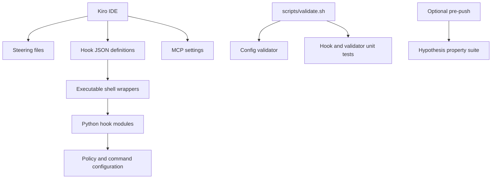

# Kiro Agent Harness Template

A reusable Kiro IDE harness for adding project context, safety checks, quality hooks, MCP servers, and a self-validator to a repository. The template includes working hook scripts and tests, plus clear places to add project-specific conventions and commands.

## What it provides

- **Steering:** always-loaded product, technology, structure, and security guidance; file-matched coding and testing rules; manual release guidance; and auto-loaded API design guidance.
- **Kiro hooks:** a destructive shell-command guard, a risky-tool confirmation guard, save-time lint and test execution, session context, prompt secret scanning, post-task tests, and a stop-time validation prompt.
- **MCP configuration:** example AWS documentation, fetch, and git servers with exact package pins and constrained auto-approval lists.
- **Config validation:** an offline Python validator for steering metadata, hook definitions and scripts, MCP settings, secrets, guard lists, and placeholders.
- **Automated tests:** standard-library unit tests, Hypothesis property tests, documentation examples, and opt-in MCP integration tests.
- **Optional Git hooks:** pre-commit validation, commit-message checks, and offline pre-push property tests. They are enabled per clone only when you run the installer.

## Requirements

- Python 3.10 or newer and POSIX sh for the validator, Kiro hook scripts, and unit tests.
- uv/uvx to launch the example MCP servers.
- Hypothesis from requirements-dev.txt to run property tests. The regular validation command does not require Hypothesis.
- A compatible Kiro IDE for the IDE hooks. The steering and hook configuration is designed for Kiro IDE; verify integration behavior in your installed version.

## Setup

1. Copy the Template into the target repository, or clone this repository and use it as your starting project.
2. Copy `.env.example` to `.env`:

   ~~~sh
   cp .env.example .env
   ~~~

3. Replace every project-specific value listed under [Placeholders](#placeholders). Configure lint and test commands in scripts/project-commands.env. Leave a command empty to skip that check.
4. In `.kiro/settings/mcp.json`, disable servers you do not need. Configure secrets as environment-variable references, document variables in `.env.example`, and keep real values in the ignored local `.env` file.
5. Run the validation command:

   ~~~sh
   scripts/validate.sh
   ~~~

Expected result: the command exits with code 0 and reports zero validation errors. Warnings may identify placeholder inventory entries that need attention. Python 3.10 or newer and POSIX sh are required. uv/uvx is needed to start the MCP servers.

6. Optionally enable the repository-managed Git hooks for this clone:

   ~~~sh
   scripts/install-git-hooks.sh
   ~~~

The Git hook installer sets the local Git option core.hooksPath=.githooks. It does not change global Git configuration. See [Git Hook Implementation Best Practices](docs/GIT_HOOKS.md) before enabling hooks, particularly if you already use another hook manager.

.env holds real credentials and must not be committed; .gitignore already excludes it.

## How the harness fits together

Kiro reads steering and hook configuration from .kiro/. Command hooks receive event JSON on standard input. Small shell wrappers invoke Python modules in isolated mode. Policy and quality settings remain in separate text configuration files, so projects can tune them without changing the hook runtime.

The validator is offline and uses only the Python standard library. scripts/validate.sh runs the validator and hook/validator unit tests. scripts/test-properties.sh runs the separate Hypothesis suite. Networked MCP startup tests and version checks are explicit opt-in commands.

## Kiro hooks

The main hook definitions are in .kiro/hooks/; implementation and policy files are in .kiro/hooks/scripts/.

| Hook | Trigger | Behavior |
|---|---|---|
| Destructive command guard | PreToolUse | Blocks shell commands matching destructive-commands.txt; malformed input or missing policy fails closed. |
| Risky tool guard | PreToolUse | Asks for confirmation for configured risky tools and arguments in risky-tools.conf. |
| Quality on save | PostFileSave | Runs the configured linter on the saved source file; runs the test command for recognized test-file names. |
| Session context | SessionStart | Adds the current Git branch and working-tree change count to session context. |
| Prompt secret scan | UserPromptSubmit | Checks submitted prompt text against configured secret patterns and blocks detected values. |
| Post-task tests | PostTaskExec | Runs the configured full test command once after a spec task. |
| Stop validation prompt | Stop | Prompts the agent to run scripts/validate.sh before finishing. |

Two optional examples are disabled in .kiro/hooks/examples/: a new-file test reminder and a pre-compact repository snapshot. Follow [CUSTOMIZING.md](docs/CUSTOMIZING.md) to enable or modify hooks.

Hook scripts require Python 3.10+ and POSIX sh. Kiro hook payload details and permission behavior can vary by IDE version; run the manual integration checklist in the customization guide when upgrading Kiro or changing hooks.

## Configure lint and test commands

Edit scripts/project-commands.env:

~~~sh
LINT_FILE_COMMAND="ruff check"
TEST_FILE_COMMAND="python3 -m pytest -q"
TEST_COMMAND="python3 -m pytest -q"
~~~

The harness appends the target file path as one argument for file-specific commands. The test hook uses single-run mode and does not start a watcher. These are examples; select commands appropriate for the host project. Leave a value empty to skip that command.

The save hook matcher in .kiro/hooks/quality-on-save.json defines the source extensions (ts, tsx, js, jsx, py, and go). The test filename pattern is configured in .kiro/hooks/scripts/quality-hook.conf.

## MCP servers and credentials

MCP servers are configured in .kiro/settings/mcp.json. The initial entries use uvx and exact package versions. Review each server's tools and permissions before enabling it.

- Use an exact package version pin; avoid @latest and version ranges.
- Keep autoApprove limited to read-only tools.
- Use ${ENVIRONMENT_VARIABLE} references for credentials. Never put real credentials in tracked JSON or Markdown.
- Document every credential variable in .env.example, then store real local values in .env, which .gitignore excludes.
- The example git MCP server is scoped with --repository .. Confirm that Kiro starts it with the workspace root as its working directory.

To compare package pins with current PyPI versions, run scripts/check-mcp-updates.sh. It requires network access and does not edit files. Review release notes and security advisories before changing pins.

## Validate and test

| Command | Purpose | Network behavior |
|---|---|---|
| scripts/validate-config.sh | Validate steering, hooks, MCP settings, guard policies, secrets, and placeholders. | Offline |
| scripts/validate.sh | Run config validation and hook/validator unit tests. | Offline |
| scripts/test-properties.sh | Run Hypothesis property tests; may provision the pinned dependency via uv or .venv. | May access a package index if the dependency is not cached |
| HARNESS_OFFLINE=1 scripts/test-properties.sh | Run property tests using installed Hypothesis; does not install dependencies. | Offline |
| HARNESS_INTEGRATION=1 python3 -m unittest tests.integration.test_mcp_servers | Start configured MCP servers and check their tools and repository scope. | Networked and opt-in |
| scripts/check-mcp-updates.sh | Compare pinned packages with current versions. | Networked and opt-in |

The optional pre-commit Git hook runs scripts/validate.sh. The commit-msg hook checks for a non-blank subject of at most 72 characters with no trailing whitespace. The pre-push hook runs the property suite in offline mode and requires Hypothesis to already be installed. Git hooks are local developer checks and can be bypassed; enforce required checks in CI or server-side branch protection.

## Repository layout

| Path | Contents |
|---|---|
| `.kiro/steering/` | Product, tech, structure, security, coding, testing, API, and release context for Kiro. |
| `.kiro/hooks/` | Kiro v1 hook definitions and disabled hook examples. |
| `.kiro/hooks/scripts/` | Hook wrappers, Python runtime modules, policy lists, and quality settings. |
| `.kiro/settings/` | Workspace-level MCP server configuration. |
| `.kiro/specs/` | Feature specs and implementation plans. |
| `.kiro/specs/example-feature/` | Example requirements, design, and task documents. |
| `scripts/` | Validator, local test commands, MCP update checker, and Git hook installer. |
| `docs/` | Customization, Git hook, project overview, and implementation status guides. |
| `.kiro/specs/kiro-agent-harness-template/` | Harness requirements, architecture design, and implementation plan. |
| `.githooks/` | Optional repository-managed pre-commit, commit-msg, and pre-push hooks. |
| `scripts/harness_validator/` | Standard-library Python config validator. |
| `tests/hooks/` | Hook script tests. |
| `tests/validator/` | Validator and template content tests. |
| `tests/property/` | Hypothesis property tests. |
| `tests/integration/` | Opt-in MCP server integration tests. |

## Documentation

- [Customizing the harness](docs/CUSTOMIZING.md): steering formats, hooks, guard lists, MCP configuration, CI example, and manual IDE checks.
- [Git hook implementation best practices](docs/GIT_HOOKS.md): hook setup, behavior, and safety.
- [Project overview](docs/PROJECT_OVERVIEW.md): architecture and subsystem responsibilities.
- [Implementation status](docs/IMPLEMENTATION_STATUS.md): current capabilities, checks, and known gaps.

## Placeholders

Replace the following project-specific placeholders before adopting the steering guidance. Notation placeholders used only in this README, specification, or documentation are intentionally examples and do not need replacement.

- `{{PLACEHOLDER_NAME}}` — .kiro/specs/kiro-agent-harness-template/requirements.md, .kiro/specs/kiro-agent-harness-template/design.md, .kiro/specs/kiro-agent-harness-template/tasks.md, docs/CUSTOMIZING.md, docs/PROJECT_OVERVIEW.md — notation example used in docs and spec files.
- `{{NAME}}` — .kiro/specs/kiro-agent-harness-template/design.md, .kiro/specs/kiro-agent-harness-template/tasks.md — notation used in the template specification.
- `{{WORKSPACE_ROOT}}` — .kiro/specs/kiro-agent-harness-template/design.md — fallback described in the template design.
- `{{PROJECT_NAME}}` — .kiro/steering/product.md, .kiro/specs/kiro-agent-harness-template/design.md — the project name.
- `{{PRODUCT_SUMMARY}}` — .kiro/steering/product.md — one sentence describing the product.
- `{{TARGET_USERS}}` — .kiro/steering/product.md — the primary users.
- `{{PRIMARY_LANGUAGE}}` — .kiro/steering/tech.md, .kiro/steering/coding-standards.md, .kiro/specs/kiro-agent-harness-template/design.md — the main programming language.
- `{{PACKAGE_MANAGER}}` — .kiro/steering/tech.md, .kiro/specs/kiro-agent-harness-template/design.md — the package manager.
- `{{SOURCE_DIR}}` — .kiro/steering/structure.md — the application source directory.
- `{{TEST_DIR}}` — .kiro/steering/structure.md — the test directory.
- `{{TEST_FRAMEWORK}}` — .kiro/steering/testing.md — the test framework.
- `{{API_STYLE}}` — .kiro/steering/api-design.md — the API style, such as REST or gRPC.
- `{{LAST_RELEASE_TAG}}` — .kiro/steering/release-checklist.md — how to identify the previous release tag.
- `{{LINT_FILE_COMMAND}}` — scripts/project-commands.env, .kiro/specs/kiro-agent-harness-template/design.md — command that lints one file.
- `{{TEST_FILE_COMMAND}}` — scripts/project-commands.env, .kiro/specs/kiro-agent-harness-template/design.md — command that runs one test file once.
- `{{TEST_COMMAND}}` — scripts/project-commands.env, .kiro/specs/kiro-agent-harness-template/design.md — command that runs the full test suite once.

The validator checks placeholder syntax and README inventory consistency. .env.example separately documents environment variables without storing real values.
