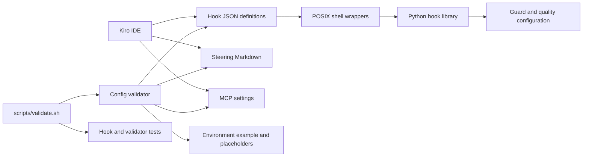

# Kiro Agent Harness Template: Project Overview

## Purpose

This repository is intended to become a reusable starter template for projects using Kiro IDE. The target harness supplies project steering, lifecycle and safety hooks, optional MCP servers, a sample feature spec, and an offline self-validator. The source of truth for intended behavior is [requirements.md](../.kiro/specs/kiro-agent-harness-template/requirements.md), with implementation choices in [design.md](../.kiro/specs/kiro-agent-harness-template/design.md).

This overview distinguishes the implemented harness from remaining limits. The core configuration validator, hook scripts, template configuration, documentation, and broad test suite are now present. Kiro IDE integration behavior still depends on the installed IDE and should be smoke-tested before release.

## Current repository snapshot

The workspace now contains README and customization docs, example and template specs, steering files, hook definitions and scripts, MCP settings, a validator package and commands, and unit/integration/property test suites. See [IMPLEMENTATION_STATUS.md](IMPLEMENTATION_STATUS.md) for a file-level inventory and remaining gaps. The task plan may lag behind implementation and should be reconciled when its progress markers are next maintained.

## Intended users and workflow

The intended user is a developer copying the template into a project and replacing project-specific placeholders. The expected workflow is:

1. Copy the starter files into a repository and fill in project steering and tool commands.
2. Review hook matchers and risky-operation lists against the installed Kiro version and project tools.
3. Configure MCP servers with pinned package versions and environment-variable references for credentials.
4. Run local validation before relying on hooks.
5. Use Kiro normally: steering adds context, pre-tool guards mediate risky actions, save hooks run targeted quality commands, and lifecycle hooks provide reminders and checks.
6. Run tests and a Kiro integration smoke test when changing hook behavior or upgrading Kiro.

The validator is designed to be offline and standard-library-only. Property tests use the pinned Hypothesis development dependency. MCP update discovery is opt-in and networked; hooks and the validator do not invoke it.

## Intended architecture

Kiro loads JSON hook definitions and invokes small executable shell wrappers. The wrappers locate the workspace and execute isolated Python modules with python3 -I so hook logic stays testable and independent of ambient Python import paths. Hooks read event JSON from standard input. Data files hold policy lists and project command configuration, keeping policy changes separate from implementation.

scripts/validate-config.sh invokes the validator; scripts/validate.sh combines validation with hook and validator unit suites. Hypothesis property tests run separately with scripts/test-properties.sh. The validator checks steering front matter, hook schema and rules, MCP configuration, secrets and placeholders, and guard policies; it renders findings and exits nonzero for errors. It does not run arbitrary hook actions during config validation.

## Main subsystems

### Steering

Markdown files in .kiro/steering/ provide product, technology, structure, coding, security, and testing guidance. Front matter selects always, fileMatch, manual, or auto inclusion. Project-specific facts should use uppercase {{PLACEHOLDER_NAME}} markers and be inventoried in the eventual README. The security guide must state least privilege, environment-based secret handling, trust-boundary input validation, and confirmation before destructive actions.

### Hooks and policies

Each hook group is a separate .kiro/hooks/<id>.json file with version "v1" and a hooks array. Implemented groups include:

- **Destructive command guard (PreToolUse):** examines shell commands against a line-based deny-pattern list. A match or unusable policy/input blocks execution (exit 2); a safe command is allowed through (exit 0).
- **Risky tool guard (PreToolUse):** checks exact tool identifiers and optional argument predicates. Matches request user approval through Kiro's hook output; malformed input or unusable policy requests approval.
- **Quality on save (PostFileSave):** runs the configured linter on the saved file only, and the test command only when the path matches the configured test-file expression. It has a bounded deadline and reports a bounded tail of failures.
- **Lifecycle hooks:** session context, prompt secret scanning, post-task tests, and a stop-time validation prompt.
- **Examples:** disabled-by-default file-create and pre-compact hooks.

Guard configuration is data-driven. Destructive patterns are one per line, with blank and comment lines ignored. Risky entries have a documented line format. Tool matchers must track tools listed in policy; Kiro tool identifiers can change and require review.

Git hooks are a separate developer workflow. The repository includes opt-in pre-commit validation/unit tests, commit message checks, and offline pre-push property tests in .githooks/. scripts/install-git-hooks.sh activates them through repository-local Git configuration. [GIT_HOOKS.md](GIT_HOOKS.md) covers setup and safe use.

### MCP configuration

The target workspace configuration is .kiro/settings/mcp.json. Server packages should be pinned to exact X.Y.Z versions, credentials should be ${ENV_VAR} references, and only known read-only tools should be eligible for automatic approval. A .env.example should document required variables without containing credentials. The validator is expected to flag unsafe auto-approval, missing environment documentation, weak version pins, and unsafe git repository scope.

### Validator and tests

The Python validator is decomposed by responsibility: hook JSON parsing/model/printing, hook rules, YAML front-matter subset parsing, steering checks, MCP checks, secret and placeholder helpers, glob matching, and report rendering. Standard-library tests cover hook scripts and validator behavior. Hypothesis property tests cover round trips, boundaries, parsing, matching, fail-closed behavior, and output contracts.

## Safety and reliability principles

- Default to least privilege for tools and MCP servers.
- Keep credentials out of tracked configuration; use environment references and ignore local secret files.
- Fail closed for the destructive command guard and fail to an approval request for the risky tool guard when input or policy is unusable.
- Match exact tool IDs where possible and keep policy lists and hook matchers synchronized.
- Bound hook execution time and terminate child process groups on timeout.
- Keep validation offline and deterministic; network version checks are an explicit maintenance action.
- Test Kiro-specific behavior against the actual supported IDE version. Hook payload fields and permission semantics are integration boundaries that Python unit tests cannot prove.

## Important design decisions

The detailed design proposes Python 3.10+ standard library for validation and hook logic, POSIX sh wrappers, and a pinned dev-only Hypothesis dependency. MCP versions are exact pins with opt-in update discovery. Hook matchers use anchored regular expressions over exact Kiro tool identifiers. These decisions reduce runtime dependencies and surprise upgrades, at the cost of requiring Python and maintaining tool IDs and version pins.

Several details are explicitly unresolved or called out for confirmation in the source design: Kiro's exact shell payload behavior across versions; whether ask is honored for risky tool calls; whether workspace MCP processes start with the workspace root as cwd; and how control_bash_process stop actions should interact with the destructive guard. These need a target-version smoke test and, where noted, requirements clarification.

## Source map

| Path | Role |
|---|---|
| .kiro/specs/kiro-agent-harness-template/requirements.md | Normative feature requirements and acceptance criteria |
| .kiro/specs/kiro-agent-harness-template/design.md | Proposed architecture, interfaces, data formats, and test strategy |
| .kiro/specs/kiro-agent-harness-template/tasks.md | Implementation breakdown and progress annotations |
| .githooks/ | Optional pre-commit, commit-msg, and pre-push implementations |
| requirements-dev.txt | Development-only Hypothesis pin |
| scripts/harness_validator/ | Validator modules and CLI |
| .kiro/hooks/scripts/ | Shell wrappers, Python hook implementations, and policy files |
| tests/ | Hook, validator, integration, and property test suites |
| README.md and docs/CUSTOMIZING.md | Onboarding and configuration guidance |
| docs/GIT_HOOKS.md | Optional Git hook implementation guidance and examples |
| docs/PROJECT_OVERVIEW.md | This snapshot and subsystem overview |
| docs/IMPLEMENTATION_STATUS.md | File-level inventory and readiness gaps |

## Keeping this document accurate

When implementation begins, update the implementation status alongside significant milestones. Once runtime files exist, verify every statement here against code and tests; move design-only content into clearly labeled rationale where implementation differs. Record supported Kiro versions and the date of external MCP/version research in operational documentation.
